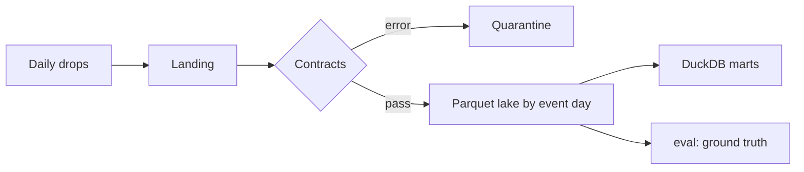
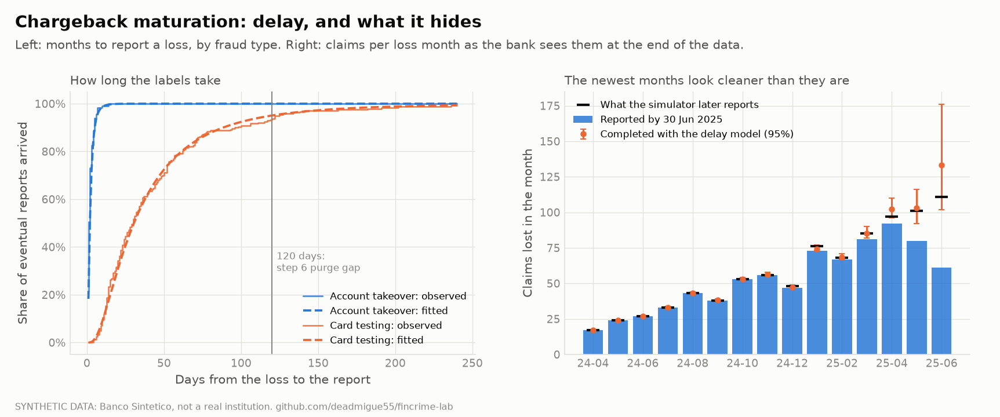
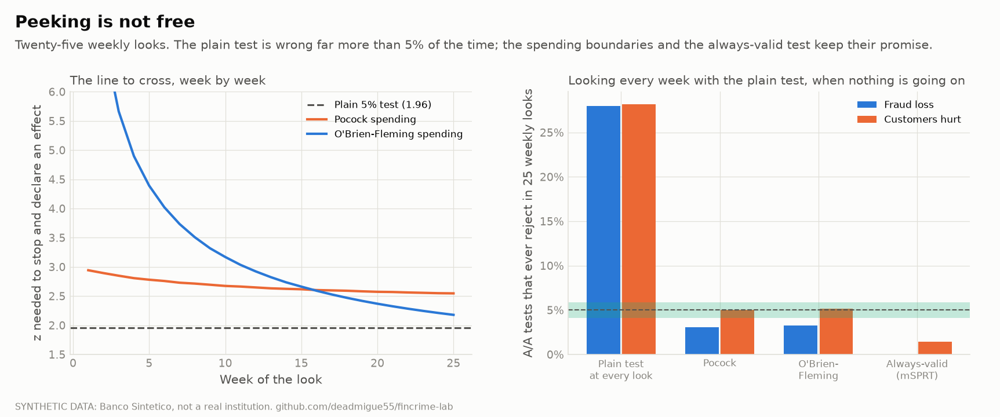

# FinCrime Lab

Fraud detection, anti-money-laundering, experimentation and fraud-loss modelling for a
**simulated Mexican neobank**, built end to end on SQL, Python and statistics.

> Status: **step 8 of 11 done**: the synthetic bank, four public benchmarks, the data platform, a
> point-in-time feature store, the fraud models and the fraud loss model and the experiment lab are built and tested; the final 180-million-row
> benchmark run is pending. Next: AML (step 9).
> Follow progress in [docs/plan.md](docs/plan.md).

## Why this project

Fintech risk teams ask for the same things: SQL and Python at scale, fraud and AML analytics,
A/B testing, and models that can be explained to a validator. This repo covers each of them on
one shared warehouse, and tests every method on data where the answer is known.

## What is in it

| Module | What it shows | Status |
|---|---|---|
| `bank` | A simulated Mexican neobank with planted fraud and laundering, calibrated to public data | done |
| `platform` | Partitioned Parquet + DuckDB, daily incremental loads, data-quality contracts, scaling benchmark up to 180M rows | built, final benchmark pending |
| `fraud` | Point-in-time features, time-based validation, delayed labels, fixed review budgets, cost-optimal thresholds, fairness, drift, BAF check | done |
| `experiments` | A/B tests of fraud rules: power, sequential testing, CUPED, guardrails, selection bias | done |
| `aml` | Rules vs graph analytics, typology coverage, alert workload | planned |
| `risk` | Chargeback maturation (IBNR-style), frequency-severity fraud losses with capital intervals, 200-bank calibration; model cards still to come | done (model cards: planned) |

## The synthetic bank (step 2)

No Mexican transaction data is public, so the project builds a bank and calibrates it to what *is*
public: the 2020 census by state, INEGI/CNBV's ENIF 2024 survey (account holding by sex, app use),
and the system-wide SPEI amount mix. Everything else is a named assumption in
[docs/assumptions.md](docs/assumptions.md), and a test fails if one is undocumented.

A full build of **200,000 customers** takes about 105 seconds on a laptop and produces
**34.7 million transactions** (455 MB of Parquet):

```powershell
uv run fincrime bank build --customers 200000
uv run fincrime bank check --customers 200000 --report docs/bank-acceptance.md
uv run fincrime figures
```


### How it is built, and why that matters

- **Three layers.** *Latent truth* (who is a mule, which attempts are fraud, what a blocked attack
  would have cost), the bank's *policy* (real-time rules that approve, ask for extra verification
  or decline), and the *observed* data (what the bank sees, plus fraud reports that arrive late
  and only for some victims). Models only ever read the observed layer.
- **Same world, different policy.** All randomness of an attack is drawn before the rules are
  consulted, so the same seed under two rule sets gives the same victims and the same attempts;
  only the decisions differ. This is what makes clean A/B tests and selection-bias checks possible
  in step 8, and it is covered by a test.
- **Attackers adapt.** A blocked takeover is retried smaller, card testers give up after a run of
  declines, some takeovers clone the victim's own phone, some use seasoned mule accounts. Without
  this, rules written by the same author as the simulator would catch everything.
- **Five crime types**: account takeover, card testing, mule forwarding, scatter-gather and
  structuring, with mule rings that share phones and carry identity-document inconsistencies.


On the 200,000-customer build the baseline rules stop 36% of account-takeover episodes outright
and block about 1.4 genuine transactions per 10,000 (customer friction, mostly extra verification
on very large transfers). No card-testing episode is stopped outright: the velocity rule trips
only after a handful of tiny charges have passed. These are properties of *this* baseline and
*these* attacker assumptions, not claims about any real bank.

### Checks

[docs/bank-acceptance.md](docs/bank-acceptance.md) holds the full report. On the 200,000-customer
build **18 of 18 checks pass**, for example:

| Check | Observed | Expected |
|---|---|---|
| State mix vs census times adoption tier | max 2.2 standard deviations | under 5 |
| Female share of customers | 0.466 | 0.463 (from ENIF 2024) |
| SPEI transfers under 10,000 pesos | 0.946 | about 0.94 (published, to verify) |
| Account-takeover episodes vs declared rate | 516 | 531 plus or minus 92 |
| Median delay until card fraud is reported | 29 days | about 30 (assumed) |
| Orphan events, duplicate ids, events before the account opened | 0 | 0 |

Identifiers (CURP, CLABE) have the right format but invalid check digits and synthetic bank
codes on purpose, so none can belong to a real person or account.

## Public benchmarks (step 3)

The simulator is checked against four public datasets so no result rests on it alone. Each is
downloaded from Kaggle with a checksum manifest, converted to typed Parquet and row-counted
against what the authors published:

```powershell
uv run fincrime ingest list
uv run fincrime ingest download baf
uv run fincrime ingest convert baf
uv run fincrime ingest report          # writes docs/benchmarks.md
```

| Dataset | What it adds | Licence |
|---|---|---|
| IBM AMLworld (Small, Medium, and Large for the scale test) | 5M to 180M transactions with labelled laundering and the planted schemes | CDLA-Sharing-1.0 |
| Bank Account Fraud (NeurIPS 2022) | six 1M-row account-opening datasets, 8 months, built-in bias and drift | CC BY-NC-ND 4.0 |
| Sparkov | 1.85M synthetic card transactions with merchants and geography | to confirm |
| IEEE-CIS | 590k real e-commerce transactions | competition rules |

Loading them corrected or sharpened several things recorded in
[docs/research.md](docs/research.md): BAF has exactly 1,000,000 rows per file and a 1.103% fraud
rate in all six; AMLworld's pattern files cover only 62% to 65% of laundering transactions in the
high-illicit-ratio sets and 24% to 29% in the low-illicit-ratio sets; and in AMLworld the payment
format ACH carries a 0.75% laundering rate against about 0.02% for every other format, a simulator
artefact a real bank would not have. Raw files are never committed, and because of the licences
only aggregate results are published. The full fact sheet is [docs/benchmarks.md](docs/benchmarks.md).

## Data platform (step 4)

The bank's data reaches analysts through a small but real platform, described in
[docs/platform.md](docs/platform.md): daily drops land by arrival date (3% of events arrive 1 to 3
days late), pass SQL data contracts, and are published to a Parquet lake partitioned by event day;
DuckDB marts are rebuilt only for the days a drop touches, and ground truth lives in a separate
`eval` schema that models never read.

It is idempotent, correctable, recoverable after a crash and able to quarantine a bad drop, and each
of those properties has a test (16 tests). Running it at full scale, 34.7 million events in 597
drops, found two flaws the small tests could not: a quadratic slowdown (fixed with an event
registry) and a cascade in which a few fraud reports that arrived before their transaction caused
185 drops to be rejected (fixed by treating out-of-order reports as a monitored warning). After
the fixes every drop loads and every report finds its event. The write-up keeps the bad run in it
on purpose.



## Fraud features (step 5)

27.2 million outgoing attempts, 37 features, built in SQL and correct in two senses of time:
event time (no future event leaks) and **knowledge time** (an event that reached the bank two days
late is not used before it arrived). Three independent tests guard it: a slow Python oracle that
matches every feature, a truncation test (delete the future and nothing moves) and a leak guard.
At full scale the planted behaviours show up as they should: account takeovers use a new device
48.5% of the time against 1.8% for everything else, card-testing bursts average 3.9 attempts in
10 minutes against 0.01. Details in [docs/fraud-features.md](docs/fraud-features.md).

## Fraud models (step 6)

Rules against a model at the same review workload, on 9.1 million held-out attempts, under a
protocol written before any model was fitted (120-day purge for label delay, four candidates, test
block touched once, intervals by account).


- At the incumbent rules' own workload (0.54% of attempts reviewed) the model finds **99.3%** of
  fraud events (95% interval 99.0 to 99.6) against **40.4%** for the rules. In **pesos** the gap is
  smaller and more honest: **97.1% against 90.2%**, because the rules already catch the big
  takeovers and miss mostly tiny card-testing charges.
- Under stated cost assumptions (MXN 15 per review, MXN 40 per genuine customer disturbed) the model
  at a review budget chosen on validation costs MXN 0.84M over the test quarter against 3.19M for
  the rules; at double the unit costs the rules cost more than doing nothing.
- Velocity features carry the result (recall falls from 99.5% to 82.6% without them), then novelty.
- **A result that is too good is a finding about the simulator.** The same pipeline on the public
  BAF benchmark finds 55% of fraud at a 5% false-positive rate, and reproduces its age disparity
  (applicants 50 and over flagged 11.4% of the time against 3.8%). Both are reported.

Full write-up, ablation, fairness and drift: [docs/fraud-models.md](docs/fraud-models.md).

## Fraud loss and IBNR (step 7)

Fraud is reported late, so the newest months always look cleaner than they are. This step completes
them (a right-truncated delay model against three chain-ladder variants), then builds a
frequency-severity loss model with an exact FFT aggregate, and checks every interval against a
truth the simulator keeps.



- Delay recovered within its intervals (takeover median 1.95 days against 2 planted, card testing
  30.5 against 30). 95.5% of reports arrive within 120 days, which independently supports step 6's
  purge gap.
- Newest six months: **454 reported, completed to 566 (95% interval 529 to 612), truth 538.**
- Annual loss MXN **9.0M** (7.4 to 11.1), **capital 2.1M** at 99.5% (1.1 to 3.8). Out of time:
  predicted 2.62M against 2.66M realised.
- **Run in 200 independent simulated banks:** the 90% interval covered the realised loss in 92%.
  The method picked before fitting (chain ladder by type) was the worst calibrated of the four there
  (69% coverage for a 95% interval); the delay model was used instead, and both are reported.

Full write-up, severity-model failure and fix, scenarios and limits:
[docs/fraud-loss.md](docs/fraud-loss.md).

## Experiment lab (step 8)

The simulator builds the same bank under two rule sets, so every customer has an outcome under both
and the true effect of a rule is known exactly. An A/B test is then a random split of those
customers, repeated thousands of times, and every method is scored against the truth.



- A/A tests reject at 4.0% to 5.0% on six metrics and three estimators; planted effects are
  recovered with 94% to 97% interval coverage. CUPED and regression adjustment cut variance by
  35% on step-ups and by nothing on fraud loss (a finding: past loss does not predict future loss).
- **Fraud outcomes are underpowered.** A rule that cuts loss by 29% is detected 32% of the time at
  100,000 customers per arm; the friction guardrail is decided in 1 to 3 weeks.
- **Peeking weekly declares a winner in 28% of A/A tests**; alpha-spending (Pocock, O'Brien-Fleming)
  holds 3% to 5%, at a cost in power that is reported.
- Late labels understate a rule's effect by 36% to 78% in 60 simulated banks; delay-model
  weighting removes the bias.
- A rollout by customer age overstates the effect 3.2 times; a failure rate per step-up stays flat
  (0.98x) while customers failed rise 2.4 times.

Two checks fell short and are reported as such (takeover-loss A/A at 4.0% against a 4.1% band edge;
a sample-ratio check misses an outcome-dependent table 16% of the time). Full write-up, power
tables and the ten protocol amendments: [docs/experiment-lab.md](docs/experiment-lab.md).

## Data

- **Banco Sintético**: described above. Not a real institution.
- **Public benchmarks** (step 3): IBM AMLworld, Bank Account Fraud (NeurIPS 2022), IEEE-CIS,
  Sparkov, used as external validation so no result rests on the simulator alone (see above).

See [docs/research.md](docs/research.md) for sources and how sure we are of each number, and
[docs/methodology.md](docs/methodology.md) for the evaluation protocol and what synthetic data can
and cannot prove.

## Quick start

```powershell
uv sync
uv run fincrime doctor
uv run fincrime bank build --customers 20000
uv run pytest
```

## Author

Miguel Vilchis, actuarial scientist. Companion to the
[Mortality Table Builder](https://github.com/deadmigue55/Mortality-Table-Builder).
