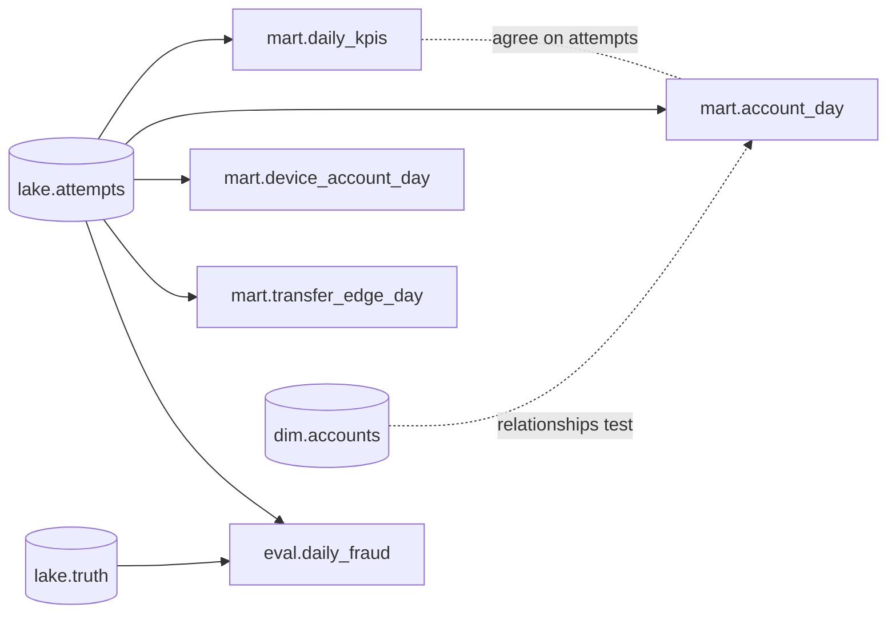

# dbt project: the marts as models with tests

The five marts that the Python pipeline builds (and that
[`src/fincrime/warehouse/sql/`](../src/fincrime/warehouse/sql) rebuilds in Databricks) are also
here as dbt models. The SQL is the same; what dbt adds is the layer around it: declared sources,
`ref()` dependencies between models, tests that run on every build, and generated documentation.



## What is tested

| Kind | Examples |
|---|---|
| Sources | `event_id` unique and not null; `status` and `direction` only take known values; every attempt has an account in `dim.accounts`; every truth row has an attempt |
| Grain of each mart | `day` unique in `daily_kpis`; one row per (`day`, `account_id`), per (`day`, `device_id`, `account_id`), per (`day`, `src_account`, `dst_account`) (custom test `unique_combination`) |
| Relationships | `account_id`, `src_account`, `dst_account` exist in `dim.accounts` |
| Late-data rule | `no_event_after_last_drop`: an event can arrive days after it happened, never before, so nothing may be dated after the last drop that loaded |
| Cross-model | `marts_agree_on_attempts`: per day, `account_day` summed over accounts equals `daily_kpis` |

`tests/test_dbt.py` (part of the normal `pytest` run) builds a small bank, copies the source tables
into a DuckDB file, runs `dbt build`, checks that the marts equal the ones the Python pipeline
produces, and then corrupts the data to check that the tests fail when they should.

## Run it

```bash
uv sync --extra dbt

# On DuckDB (needs a database file that already holds the lake.*, dim.* and ops.* tables)
FINCRIME_DBT_DB=path/to/fincrime.duckdb uv run dbt build --project-dir dbt --profiles-dir dbt

# On Databricks (the tables from docs/databricks-metabase.md; reads DATABRICKS_HOST,
# DATABRICKS_HTTP_PATH and DATABRICKS_TOKEN from the environment)
uv run dbt build --project-dir dbt --profiles-dir dbt --target databricks

# Browse the documentation and the lineage graph
uv run dbt docs generate --project-dir dbt --profiles-dir dbt
uv run dbt docs serve --project-dir dbt --profiles-dir dbt
```

## Limits

- The Databricks target writes the same `mart.*` and `eval.*` tables the SQL port wrote, so a run
  replaces them with identical content (`fincrime warehouse reconcile` still applies).
- Every model is a full rebuild (`table`), like the Databricks port. The DuckDB pipeline's per-day
  incremental refresh is not modelled as an `incremental` dbt model.
- `eval.daily_fraud` reads ground truth and is tagged `eval`; keep it out of anything a model trains on.
- CI runs only the DuckDB target on a small bank; no Databricks secret is stored in GitHub.

## Checked on Databricks

A run against the Free Edition SQL warehouse on 2026-11-05 finished with
`PASS=34 WARN=0 ERROR=0` (5 models and 29 tests, on the full 34.7-million-row bank).
