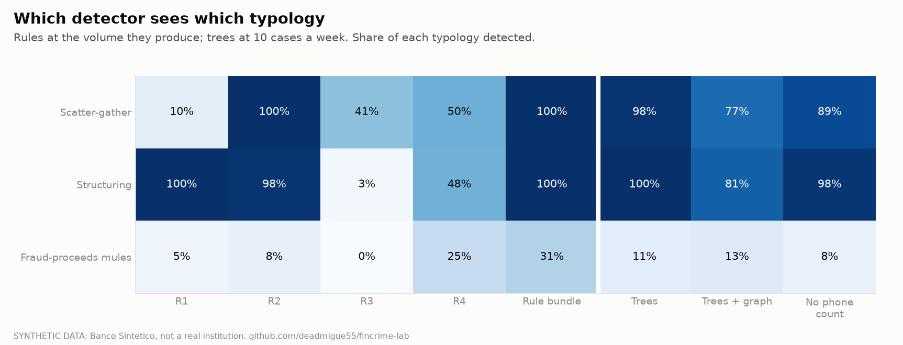
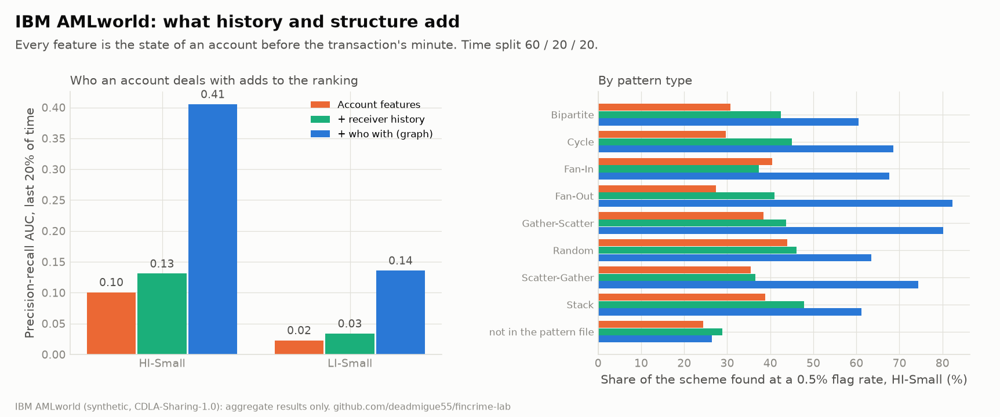

# AML module (step 9)

Can rules, boosted trees and a transaction graph find planted money laundering, and how many cases
a week does each need to open to do it? The protocol (section 10 of [methodology.md](methodology.md))
was written before any detector was scored; the ten amendments after it say what changed and why.
Numbers below come from `docs/aml-results/results.json`, which `fincrime aml run` writes.

## Read this first

- **The data is synthetic and the laundering is planted by the same author as the rules.** The rules
  (R1 to R4) were written against the typologies the simulator plants, so their near-perfect coverage
  is partly by construction. The comparison is useful for workload and for how detectors fail, less
  for "which is better in real life".
- **Few rings.** 219 episodes come from 48 rings. Intervals are bootstrapped over rings, and they are
  wide where it matters (see the refit range for the graph model).
- **Shared phones separate rings by construction.** No genuine phone is shared in the simulator, so a
  phone shared by four accounts is a ring. That is a simulator artefact; the ablation below isolates it.
- **The truth is complete and the bank sees one side.** Every laundering event is labelled, and the
  bank sees only its own accounts: transfers leaving the bank are invisible after they leave. No
  feedback loop: investigators never block or freeze anything.
- **The structuring line (15,000 MXN) and the investigator hours (4 hours a case, 35 hours a
  full-time week) are named assumptions.** Change them in `build.py` and `evaluate.py`.
- **The headline comparison is saturated.** At 20 cases a week every detector finds essentially every
  episode, and one rule (R2, pass-through) alone finds 99%. The primary measure cannot rank
  detectors; the differences are at 5 to 10 cases a week, on fraud-proceeds mules, and on the
  benchmark. Reported as it came out (amendment 9 and 10).

## 1. Design

**What is planted.** 50 mule rings, 219 laundering episodes (111 scatter-gather: money in from many
senders, out to many receivers in a day or two; 108 structuring: cash deposits just under the
reporting line), mule accounts that age quietly with card spending before use (`mule_aging`), and
fraud proceeds forwarded through mules (`mule_forward`: 272 approved events). Genuine traffic
is 1.42 million account-to-account transfers among 162,283 accounts and 1.14 million cash-ins.

**Truth.** An account-week is positive if it holds an event of scatter-gather, structuring or
mule-aging. `mule_forward` is a separate typology row, never a positive in the main score. An
episode is *detected* if any account of the episode is in an opened case in a week the episode is
active or the week after.

**Weekly batch monitoring.** Weeks run Monday to Sunday from 2024-01-01 (78 weeks). Each Monday the
bank scores every account on what it knew at the end of the previous week (a test checks that a
snapshot never reads past its week). Alerted accounts are grouped into cases when they are linked by
a transfer or a shared phone in the lookback (4 weeks by default).

**Detectors.**

| Id | What it is |
|---|---|
| R1 | structuring: at least 3 cash-ins at 80% to 100% of the line within 7 days |
| R2 | pass-through: in a 2-day window, at least 50,000 in and at least 80% of it out again |
| R3 | fan-out: at least 4 distinct internal counterparties in 2 days, at least 100,000 |
| R4 | shared phone: at least 4 other accounts seen on the account's phone in the lookback |
| M0 | the union of the rules; `M0cut` cuts it to a case budget, ranked by pesos |
| M1 | boosted trees on account features (counts, pesos, cash, near-line cash-ins, pass-through ratio, age) |
| M2 | M1 plus graph features (degree, neighbours' degree, two-hop reach, component size and flow, neighbours' pass-through and age, accounts on the same phone) |
| M2n | M2 without the shared-phone count (a *partial* ablation: phones still link cases) |

Folds are five, by ring (all accounts of a ring in one fold; non-ring accounts at random), so a
model is never tested on a ring it trained on. Each model is refitted five times and the mean is
reported with the range of the refits.

**Measures.** Primary: share of episodes detected at 20 cases a week, with a ring-cluster bootstrap
interval. Secondary: typology coverage, the workload curve, precision, delay in days, lookback
sweep, ablation, ring prevalence at half and double (full 200,000-customer bank rebuilt each time), and
the AMLworld benchmark.

## 2. Results


### Rules at their natural volume (lookback 4 weeks)

| Rule | Episodes found | Cases a week | Precision | Fraud-proceeds mules |
|---|---|---|---|---|
| R1 structuring | 54.3% (structuring 100%, scatter-gather 10%) | 6.8 | 0.99 | 5% |
| R2 pass-through | 99.1% | 8.0 | 0.37 | 8% |
| R3 fan-out | 22.4% | 0.7 | 0.93 | 0% |
| R4 shared phone | 48.9% | 3.5 | 0.60 | 25% |
| **All four (M0)** | **100%** | **14.8 (1.7 investigators)** | 0.56 | 31% |

Precision is the share of cases containing an account that laundered that week or the week before
(amendment 4); `ring_share` in the JSON also reports cases that contain any ring account. At a
13-week lookback R4 floods: 73% of episodes at 13.5 cases a week, and the bundle needs 22.6 cases
a week (2.6 investigators).

### Trees, with a case budget

| Cases a week | Rule bundle (cut) | Trees (M1) | Trees + graph (M2) | M2 refit range | No phone count (M2n) |
|---|---|---|---|---|---|
| 5 | 65.8% | **89.7%** | 65.2% | 2% to 89% | 80.8% |
| 10 | 89.0% | **98.9%** | 79.3% | 8% to 98% | 93.4% |
| 20 | 100% | 100% | 85.4% | 27% to 100% | 99.9% |
| 50 and 100 | about 100% | about 100% | about 100% | | about 100% |

At 5 cases a week, trees beat the cut rule bundle by 24 points (95% CI 16 to 32) and the graph
model is 24 points *below* the trees (CI 20 to 28). The graph model is **not stable**: one refit of
five finds 2% of episodes at 5 cases a week and another 89%. Fewer than 50 rings train the model,
and a few features (a phone count that separates rings perfectly in training) dominate the trees.
Dropping that count (M2n) recovers most of the loss, which shows what the simulator is rewarding.
Delay from the episode's first event to the end of the alerting week has a median of 3.5 to 7.6 days.

### Typology coverage



Rules see structuring and scatter-gather almost perfectly as a bundle, but each alone covers a slice
(R1 sees 10% of scatter-gather, R3 3% of structuring). The fraud-proceeds mules are the hard
typology: they look like ordinary customers forwarding a one-off payment. The rule bundle catches
31% (61% at a 13-week lookback); the graph model catches more as the budget grows (44% at 100
cases a week against 22% for the trees on account features), and that is where a graph is worth
having in this bank.

### Sensitivity

| Change | Result |
|---|---|
| Lookback 1 week | M2 94% at 5 cases a week (stable); fewer rule flags |
| Lookback 2 weeks | M2 64% at 5 (refit range 4% to 93%) |
| Lookback 13 weeks | M2 77% at 5 against 32% for the cut rules (R4 floods the rule queue) |
| Half the rings (22 rings, 86 episodes) | the models collapse: M1 31%, 38%, 52% at 5, 10, 20 cases; the cut rules hold 73%, 93%, 100% |
| Double the rings (99 rings, 401 episodes) | models do best: M1 72%, 94%, 98.5% at 5, 10, 20; cut rules 46%, 74%, 95% |

The pattern is the usual one. With few positive rings, supervised models have little to learn from
and rules written from domain knowledge do better; as ring volume grows the models overtake them.

### Case summaries

[case-summaries.md](aml-results/case-summaries.md) holds three SAR-style plain-text summaries
written from the weekly tables alone (no truth column in the text): a structuring case, a 7-account
scatter-gather ring with 97% pass-through, and a case flagged by the model that contains no
laundering. The three were chosen with the truth to illustrate one of each kind; they do not sample.

## 3. AMLworld benchmark

The IBM AMLworld benchmark (HI-Small, LI-Small; time split 60 / 20 / 20) tests the same question on
a different generator. Every feature is the state of an account strictly before the transaction's
minute (a test checks it, including rows in the same minute). Three feature sets so that "the graph
helps" is not confused with "more history helps": own fields and sender history (T); plus the
receiver's history (TR); plus who the account deals with (distinct partners, pair seen before) (G).



| | PR-AUC T | PR-AUC TR | PR-AUC G | Recall at 0.5% flagged (T / TR / G) |
|---|---|---|---|---|
| HI-Small (test: 1,015,669 transactions, 1,797 positives) | 0.10 | 0.13 | **0.41** (0.39 to 0.43) | 33% / 39% / **61%** (56% to 66%) |
| LI-Small | 0.02 | 0.03 | **0.14** | 23% / 35% / **52%** |

The graph set is worth about 3 times the PR-AUC of the history-only set. By pattern in HI-Small, G
finds 82% of fan-out, 80% of gather-scatter, 74% of scatter-gather, 69% of cycles and 68% of fan-in.
Laundering that is **not in the pattern file** (the generator's unlabelled part) stays at 26%, the
same as without the graph, which is a limit worth stating: a graph helps where laundering has shape.
I have not compared these numbers with published AMLworld results; take them as this pipeline's.

## 4. What I would do differently

- Add rings, not rows. Everything that is unstable here is a few-rings problem; the first thing a
  real project would buy is more confirmed cases.
- Keep trees on account features as the first model and the rules as a safety net. Add graph
  features when the data has enough positives and the phone-sharing is not an artefact.
- Rank by log-odds, never by probability (probabilities saturate at 1.0 and tie).
- Always refit and report the range. Single fits disagreed by 44 points at 5 cases a week (amendment 1).

## 5. Reproduce

```
fincrime bank build                  # the 200,000-customer bank, if not built yet
fincrime aml run                     # long; --skip-prevalence skips the two extra full banks
fincrime aml report                  # figures and case summaries from the results file
```

Weekly tables are written to `data/processed/aml/` (gitignored). Code: `src/fincrime/aml/`
(`build`, `snapshots`, `detect`, `evaluate`, `amlworld`, `cases`, `pipeline`, `report`); tests:
`tests/test_aml.py`.
