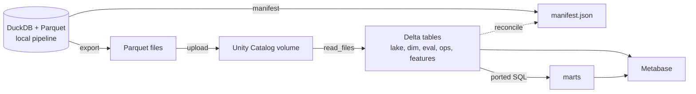
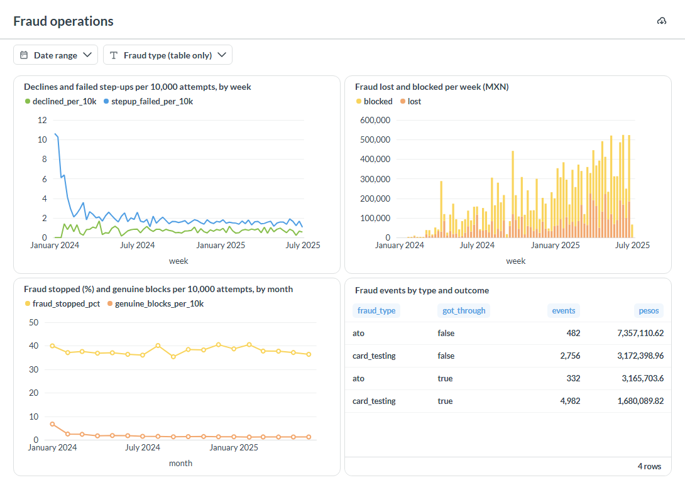
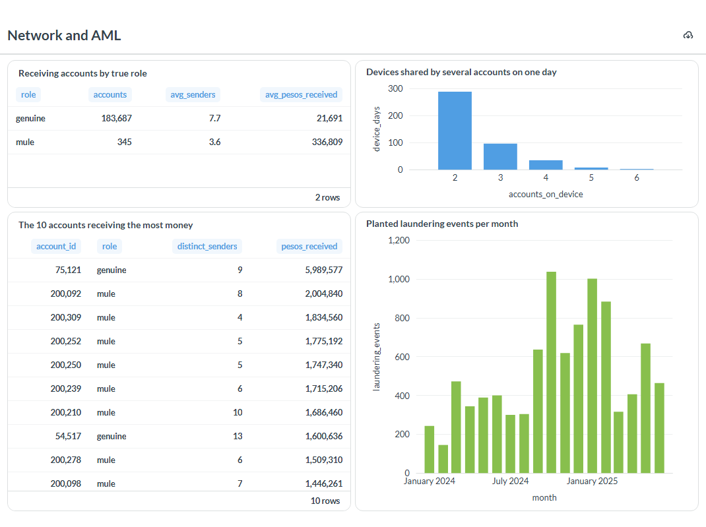
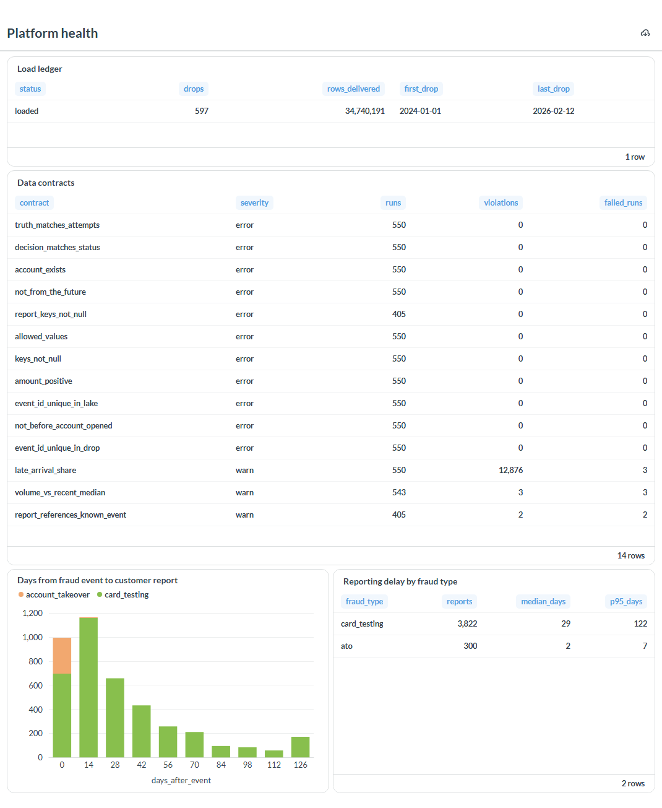

# The data in Databricks, explored in Metabase

The bank's data lives in DuckDB and Parquet and the Python pipeline (generator, features, models,
loss, AML) runs against those files. This page describes a second copy of the same data in
Databricks, a rebuild of the marts there in Databricks SQL, and three Metabase dashboards on top.
It was done on the free tiers: Databricks Free Edition and open-source Metabase 0.65 running on a
laptop. Nothing in the modelling depends on it, and nothing here is a production deployment.

## What was copied, and the proof that nothing was lost

Before anything moved, `fincrime warehouse manifest` fingerprinted every table with plain SQL (row
count; per column the null count, sums, minimum and maximum, distinct counts, string lengths, true
counts, date and timestamp bounds). The result is committed as
[warehouse/manifest.json](warehouse/manifest.json). After loading, `fincrime warehouse reconcile`
computes the same fingerprint in Databricks and compares. Integers must match exactly and decimals
within a relative 1e-9 (two engines add the same numbers in a different order).

| Table | Rows | How it got there |
|---|---|---|
| `lake.attempts`, `lake.truth` | 34,739,680 each | uploaded as Parquet, created as Delta tables |
| `lake.reports` | 4,122 | uploaded |
| `dim.accounts`, `eval.accounts` | 200,390 each | uploaded |
| `ops.load_ledger`, `ops.dq_results` | 597 and 7,403 | uploaded |
| `features.fraud_events` | 27,175,021 | uploaded (the model feature store) |
| `mart.daily_kpis`, `mart.account_day`, `mart.device_account_day`, `mart.transfer_edge_day`, `eval.daily_fraud` | 547; 21,025,130; 10,228,764; 1,421,429; 547 | **rebuilt** in Databricks SQL from the uploaded tables, not copied |

All 13 tables reconcile as identical. Left out on purpose: `ops.event_registry` (a DuckDB-internal
index whose every row is already in `lake.attempts`), the DuckDB `filename` column (the local path
of each source file, a machine detail rather than data) and the public benchmark datasets, which
have their own licences.

The marts are the part that exercises the platform: the five queries in
[`src/fincrime/warehouse/sql/`](../src/fincrime/warehouse/sql) are the Databricks SQL versions of
[`src/fincrime/lake/sql/`](../src/fincrime/lake/sql). The incremental per-day refresh became a
full `create or replace table`, and `x::varchar` became `cast(x as string)`. A test checks that they
produce the same marts as the DuckDB refresh on a small bank, and the reconciliation checks it on
the full one. On Free Edition's single 2X-Small serverless warehouse the three large tables load in
11 to 17 seconds each and the five marts rebuild in 38 seconds.

## The dashboards

Each chart is a saved SQL question in [`dashboards/`](../dashboards), one file per chart. The Fraud operations dashboard
has two filters, a date range and a fraud type, built as Metabase field filters: a `[[where {{day}}]]` line in the SQL
that a dashboard control fills in, so someone who does not write SQL can ask for one quarter or one fraud type.

**Fraud operations** ([queries](../dashboards/fraud-operations))

Declines and failed step-ups are rare and settle quickly. The first weeks are high on friction
because at launch every device and beneficiary is new, so the `new_device_amount` and
`young_beneficiary` rules fire on genuine customers; later the share of fraud attempts blocked holds around
35% to 40% at about 1 to 2 genuine blocks per 10,000 attempts.

**Network and AML** ([queries](../dashboards/network-and-aml))

Mule accounts do not receive from more senders than genuine accounts (3.6 on average against 7.7);
they receive far more money (336,809 pesos on average against 21,691). Ranking receivers by amount
puts mules at the top, but not exclusively: one genuine account is first, which is why a single
number is not a rule.

**Platform health** ([queries](../dashboards/platform-health))

All 597 drops loaded, and the 11 blocking contracts found no violation. Card-testing fraud is
reported a median of 29 days after the event and account takeover after 2, which is why the
[fraud-loss model](fraud-loss.md) treats recent months as incomplete.

## Reproducing it

1. Create a Databricks account and a personal access token, and store them in a Databricks CLI
   profile named `fincrime` (`FCL_DATABRICKS_PROFILE` selects another profile). Credentials are
   read from that profile; none are stored in this repository.
2. `uv sync --extra databricks`, then `uv run fincrime warehouse export` and
   `uv run fincrime warehouse load` (create the catalog `fincrime`, upload, load, rebuild the
   marts), then `uv run fincrime warehouse reconcile`.
3. Start Metabase, add a Databricks database with the workspace host, the SQL warehouse HTTP path
   and the token, set the catalog to `fincrime`, and paste the queries from `dashboards/` (in the Fraud operations queries, the `[[...]]` lines are Metabase
   filters: keep them in Metabase, delete them to run the query in the Databricks SQL editor).

## Limits

- Free Edition is for non-commercial use, has one 2X-Small SQL warehouse and does not allow
  changing its idle timeout, so Metabase's schema sync is set to once a day.
- Metabase keeps dashboards in its own application database, which is not part of the repository.
  The queries and the screenshots above are what is versioned here.
- The `eval` schema holds ground truth and is used here for evaluation views only; a model must
  never read it.
