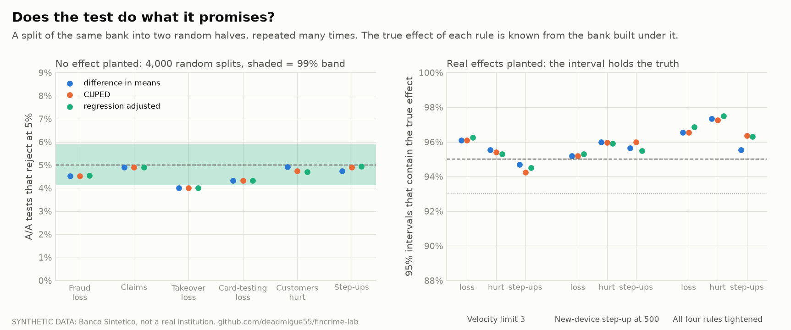
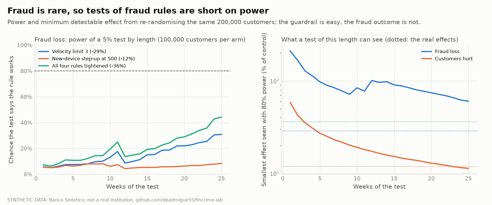
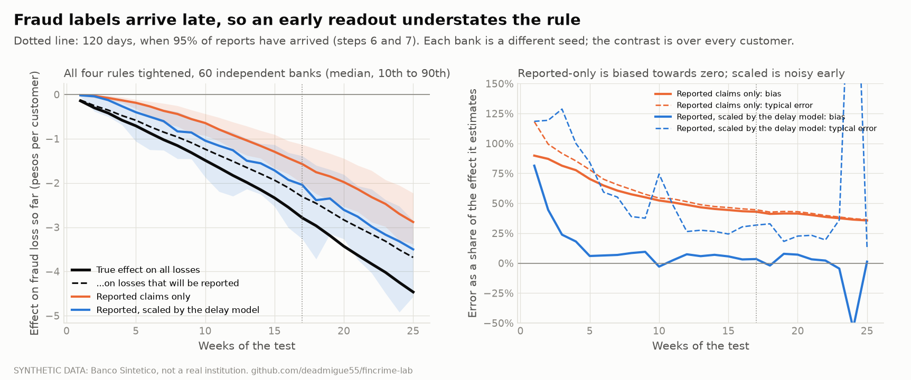
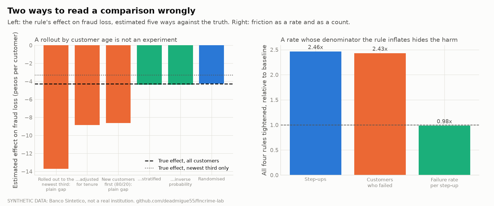

# Experiment lab (step 8)

How to test a fraud rule on customers, how often the test is wrong, and four ways it goes wrong in
practice. The protocol (section 9 of [methodology.md](methodology.md)) was written before any
outcome table was read; the ten amendments after it are listed there with the reason for each.
Numbers below come from `docs/experiment-results/results.json`, which the `report` command writes.

## Read this first

- **The data is synthetic.** Banco Sintético is a simulator, so every effect here is known exactly.
  That is the point (a method that cannot recover a known effect cannot be trusted on an unknown
  one), and also the limit: real banks have interference, drift and messier outcomes.
- **One bank, one seed** for the main study (200,000 customers). Only the delayed-label study
  (V5) uses many banks (60). Conclusions about power are for this bank's fraud rate.
- **Two checks fell short and are reported as such**: V1 (A/A false-positive rate for takeover
  loss is 4.0%, just under the 4.1% lower edge of the band; it is conservative, not inflated) and
  the detection of an outcome-dependent sample loss (V3, 83.9%).
- **The headline is a negative one.** For fraud loss, no rule is detected at 80% power in 25 weekly looks
  with 100,000 customers per arm. The guardrail (friction) is decided in one to three weeks.

## 1. Design: the truth comes from two banks

The simulator draws all randomness before any rule is applied, and a rule sees only an attempt's
own features. So the same seed built under two rule sets gives every customer an outcome under
both. The true effect of a rule is the mean of `outcome(rule) - outcome(baseline)` over all 200,000
genuine customers, with no estimation. An experiment is then a random split of the same customers:
customer `i` in the treated half shows its outcome under the new rule, in the control half under
the baseline (re-randomisation Monte Carlo). Repeating the split gives the sampling distribution of
any estimator, and the truth to score it against.

| Treatment | Change | True effect on fraud loss | Friction |
|---|---|---|---|
| `velocity3` | velocity limit 6 to 3 | **-4.26 pesos per customer (-28.7%)**; card-testing loss -75.7%, takeover exactly 0 | none |
| `device500` | new-device step-up from 3,000 to 500 | -1.75 (-11.8%) | customers failing +50%, step-ups +50% |
| `tight_all` | the two above, plus young-counterparty at 500 and night at 1,000 | -5.34 (-36.0%) | customers failing +143%, step-ups +146% |

Baseline mean fraud loss is 14.86 pesos per customer over the 26 calendar weeks (2025-01-01 to 2025-06-30; 25 whole weeks are read),
and it is heavy-tailed: 0.33% of customers have a claim.

Unit: the customer, all 200,000 genuine customers (amendment 1; the first estimate of 190,000
eligible was wrong, the real count of those onboarded before 2025 was 117,894). Pre-period: the
six months before, in the baseline bank. The treated banks run the new rules from 2024-01-01 and
only 2025 is analysed. This equals a switch on 2025-01-01 because features do not depend on the
rule and episodes are independent.

Metrics: **P1** fraud loss per customer; **S1** claims; **S2** takeover loss; **S3** card-testing
loss; **G1** customers with a failed verification or decline; **G2** step-ups per customer.

## 2. Estimators

| Id | Estimator | Notes |
|---|---|---|
| E1 | difference in means, Welch standard error | the baseline |
| E2 | CUPED, the metric's own pre-period value as covariate | one pooled coefficient |
| E3 | Lin's interacted regression on five covariates | log pre-period outgoing count and pesos, pre failed count, pre step-ups, tenure; per-arm residual variance |
| P | permutation test | exact under the null; a hypergeometric shortcut over the non-zero outcomes makes 2,000 runs of 499 shuffles feasible |

**Variance reduction is about zero for fraud metrics.** Pre-period loss is uncorrelated with next
half-year loss in this bank (fraud hits customers at random), so CUPED and Lin cut variance by
under 0.1% for loss and claims. For step-ups, whose history is predictive, CUPED cuts it 35% and
Lin 36%. This is a finding, not a failure of the code: CUPED is valuable for the guardrail, not for
the outcome the rule exists to move.

## 3. V1 and V2: does the test do what it promises?



**V1, A/A (4,000 random splits, 99% band 4.1% to 5.9%).** All 18 estimator-metric cells fall inside
except takeover loss (4.0% for E1, E2 and E3). The three estimators agree to the third decimal,
as expected when the covariates are uninformative. Takeover loss is the heaviest tail, where the
normal approximation is conservative; a test that rejects too rarely costs power, not validity.
The permutation test (2,000 splits, band 3.8% to 6.3%) gives 3.7% for loss (just below the band,
as Welch does at 3.8%), 4.3% claims, 4.2% takeover and 4.6% card testing. V1 as written fails
by 0.1 points on one metric; it is recorded as failed.

**V2, planted effects (2,000 splits per treatment, 54 cells).** Bias within 3 Monte Carlo
standard errors in every cell (worst 2.01; the protocol said one standard error and amendment 6
changed it, with 6 of 54 cells over one). Coverage of the 95% interval is 94.2% to 97.5%
everywhere, above the 93% floor.

## 4. Power: fraud is rare, so the test of a fraud rule is short of it



At the last look (week 25) with 100,000 customers per arm, power for a 5% test on fraud loss is
**32% for `velocity3`, 8.7% for `device500` and 46% for `tight_all`**. A rule that cuts loss by a
third is missed more often than caught. Three reasons stack: 99.7% of customers have no claim, the
amounts are heavy-tailed, and the loss of a rule that bites hard on card testing is dominated by a
few large episodes.

| Customers per arm for 80% power | Fraud loss | Card-testing loss | Friction (G1) |
|---|---|---|---|
| `velocity3` | 354,000 | 69,000 | (no effect to find) |
| `device500` | 2.40 million | 1.41 million | **6,000** |
| `tight_all` | 224,000 | 56,000 | **1,000** |

Reading it: the same experiment that cannot see the benefit sees the cost within the first week.
A team that stops when the guardrail moves has no evidence about the benefit; a team that waits for
the benefit needs about 3.5 times the customers it has. The minimum detectable effect after 25
weeks is 62% of the control mean for fraud loss and 11% for customers failing. Aiming at card-testing
loss alone (the part `velocity3` actually moves) brings the needed sample down 5-fold.

## 5. V4: peeking


Looking every week and stopping at the first p below 0.05 declares an effect in **28% of A/A
experiments** (25 looks), for both loss and friction. The fix is a boundary that spends the 5%
across the looks:

| Procedure (A/A, any-reject over 25 looks) | Fraud loss | Friction |
|---|---|---|
| Plain test at every look | 28.0% | 28.2% |
| Pocock-type spending | 3.1% | 5.0% |
| O'Brien-Fleming-type spending | 3.3% | 5.2% |
| mixture sequential probability ratio test (always valid) | 0.0% | 1.4% |

All three corrected procedures stay at or below 5% (V4 passes one-sided: the harm is inflation).
Loss under both spending boundaries and mSPRT, and friction under mSPRT, are below the band, i.e.
conservative. The price is power: on fraud loss, `velocity3` is found by 25% of experiments with
O'Brien-Fleming and 19% with Pocock (52% with the plain test, which is not allowed to be used), and
by 0% with mSPRT. The mSPRT mixing width was set from the pre-period (amendment 7); with the
protocol's original width (25% of the control mean) it finds `tight_all` loss 5.6% of the time.
Never in 25 weeks does any procedure reach 80% power on fraud loss.

For friction the same procedures stop quickly: the median stopping week for `device500` is 3
(Pocock, mSPRT) to 5 (O'Brien-Fleming), and for `tight_all` 1 to 3. Wrong-sign stops: the plain test
calls `velocity3` loss the wrong way in 5.6% of the runs it stops (14% for `device500`); the boundaries
do so in at most 0.5% for `velocity3`, but 2.5% to 4.5% for `device500`, whose effect is barely visible.
The guardrail is never stopped with the wrong sign when the friction effect is real.

The boundaries are numerical (Lan-DeMets spending, grid integration) and were tested: the any-cross
rate of the OBF boundary under simulation is 5.0%, the one-look boundary is 1.96 and the first
OBF boundary equals 1.96 over the square root of the information fraction.

## 6. V5: late labels



Fraud is reported late (step 7: median 2 days for takeover, 30 for card testing), so an experiment
read at four weeks counts only the claims that have come in. Across **60 independently simulated
banks** (so the particular delays and the never-reported share are different each time), for
`tight_all`:

| Week | True effect, all losses | Reported only, bias | Delay-model weighted, bias (vs losses that will be reported) | Weighted, typical error |
|---|---|---|---|---|
| 4 | -0.58 | -78% | +18% | 100% |
| 8 | -1.16 | -58% | +8% | 39% |
| 13 | -1.99 | -47% | +6% | 27% |
| 17 (120 days) | -2.79 | -43% | +3% | 32% |
| 25 | -4.46 | -36% | +1% | 13% |

(Bias is the share by which the estimate is closer to zero than the effect it targets.)

The unweighted readout understates the rule by 36% to 78% and is biased all the way to the end of
the test; weighting each reported claim by one over the delay model's completion factor removes the
bias, at the cost of a very wide spread in the first month. The target of the weighted readout is
the effect on losses that will *eventually be reported*, not on all losses: the gap (19% at week 25)
is the never-reported share, which no readout can learn from reports, and which step 7 treats as a
named assumption. An early version of this study weighted by the simulator's own report rate; an
independent review caught that as a leak, and amendment 8 removed it and recomputed everything.

## 7. V6: two ways to read a comparison wrongly



**A rollout by customer age is not an experiment.** If the new rule goes to the newest third of
customers first and the comparison is "new customers against the rest", `velocity3` appears to
cut loss by **13.7 pesos per customer; the truth is 4.26** (3.2 times too much), and the effect
among just those newest customers is 3.29. Adjusting for tenure by regression still gives 8.8. A
softer rollout (80% / 50% / 20% treated by tenure tercile) overstates by about 2 times (-8.6) with a plain gap;
stratifying by tercile or weighting by the inverse of the assignment probability recovers it
(-4.36); randomising recovers it (-4.23). The same pattern holds for the other two rules. The
deterministic rollout has no overlap, which is why it cannot be fixed by weighting (amendment 3).

**A rate whose denominator the rule inflates hides the harm.** Under `tight_all` the failure rate
per step-up goes from 3.1% to 3.0% (0.98 times) while step-ups rise 2.46 times and customers who
failed 2.43 times. A dashboard tracking the rate would show the rule as friction-neutral. The other
ratio, fraud pesos per 1,000 genuine pesos moved, has the same effect as the per-customer figure
(-28.7% for `velocity3`), so it is safe here: the trap needs a denominator the rule changes.

## 8. V3: the table the test reads

An experiment is only as good as its analysis table. Customers split by an independent coin per
customer (as a hash of the id does) and the arm counts tested against 50/50 at p below 0.001:

| Analysis table | Flagged | Friction estimate (truth +0.0064) |
|---|---|---|
| complete | 0.0% | +0.0064 |
| 0.2% of treated missing at random | 0.2% | +0.0064 |
| 1% missing at random | 15.4% | +0.0064 |
| 5% missing at random | 100% | +0.0064 |
| treated customers who failed verification missing | 83.9% | **-0.0126** |

Random loss biases nothing but is caught when it is large. A loss that depends on the outcome is
the dangerous case: it flips the friction estimate to the wrong sign and still escapes the check
one time in six. The check is necessary, not sufficient. The pass mark in the protocol is the clean
table and the 5% loss (amendment 10); the 84% is reported as a finding.

## 9. What was counted

Variants tried and reported: 3 estimators, 3 treatments, 6 metrics, 4 sequential procedures, 2 mSPRT
width choices, 6 estimators for the selection study. Every one appears in the tables; none was
dropped after being seen. The results that disappointed (V1 on takeover loss, power on loss, the
mSPRT, V3 detection) are in the same tables as the ones that did not.

## Limits

- **No interference.** The simulator has no spillover between customers; real fraud rings and
  shared devices break the assumption that one customer's rule does not move another's outcome.
- **One bank for V1 to V4 and V6.** The standard errors are the Monte Carlo's, not between-bank;
  V5 is the only multi-bank result.
- **Rule switch at 2025-01-01 is a simulation device** (section 1); a live test starts with
  customers already in the middle of an episode, whose clock is truncated here.
- **Tenure is not knowable in advance for customers who arrive during the test**, so it is not
  used in the sequential paths.
- **Fraud prevalence is an assumption** (step 2). Power scales with it; a higher claims rate
  shrinks the sample needed roughly in proportion (not rerun).
- **The mixture test is tuned by a pre-period schedule**; other widths trade power at one horizon
  for power at another.

## Reproduce

```powershell
uv run fincrime experiments build      # baseline and the three treated banks, 200,000 customers
uv run fincrime experiments run        # V1 to V4 and V6 studies (about 25 minutes on 5 workers)
uv run fincrime experiments labels     # V5, 60 banks
uv run fincrime experiments report     # results.json and the five figures
uv run pytest tests/test_experiments_*.py
```

Code: `src/fincrime/experiments/` (`worlds` builds the two-rule banks, `outcomes` the per-customer
tables, `analysis` the estimators, `sequential` the boundaries, `study` the Monte Carlo,
`labels` the multi-bank study, `report` the figures).
