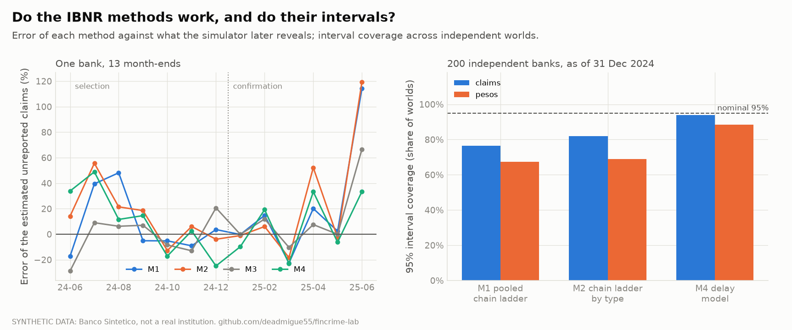
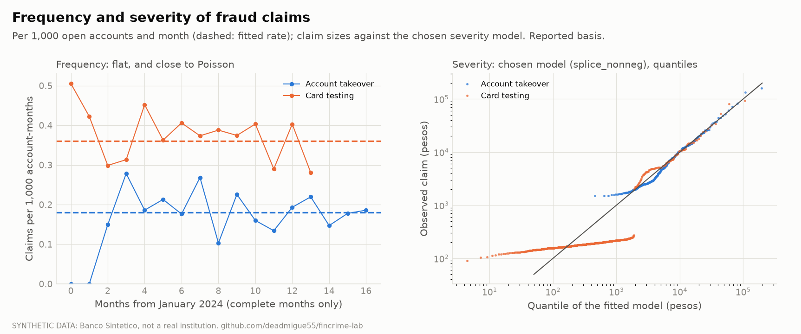
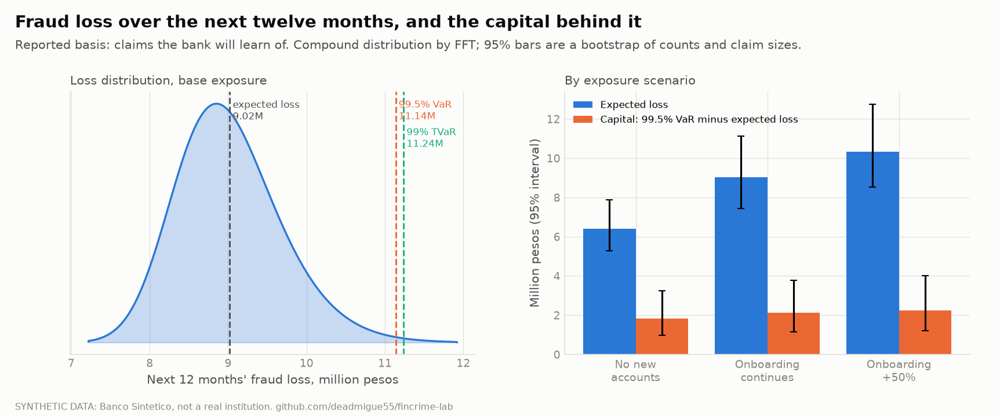
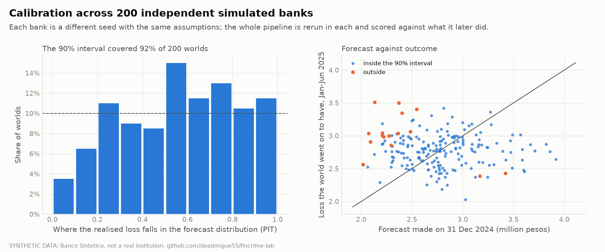

# Chargeback maturation and fraud loss model (step 7)

Fraud losses are reported late, so the newest months always look cleaner than they are. How many
claims are still to come, what is the annual fraud loss, how much capital does it need, and how
sure are we of each number? This is the actuarial question of IBNR (incurred but not reported)
plus a frequency and severity loss model, answered on the synthetic bank under a protocol fixed
before fitting ([methodology.md](methodology.md) section 8, committed in `60468aa` before any
model was fitted; amendments are listed there and below). Code: `src/fincrime/risk/`; raw results:
[docs/risk-results/results.json](risk-results/results.json). Reproduce: `fincrime risk worlds`
(the 200 simulated banks), `fincrime risk report`.

**Read this first.** Everything is on one synthetic bank (200,000 customers, 18 months, 1,102 fraud
claims) whose delay and report rates were planted by us, so we can check the methods against the
truth, which no real bank can. That is the point of the exercise and also its limit: the numbers
say the *method works when its assumptions hold*, not what a real bank's capital would be. The
99.5% capital figure rests on a fitted tail of about 30 takeover and 60 card-testing claims and is the least certain
number in this document. A second, equally important finding: the method the protocol picked
before fitting (chain ladder by fraud type) turned out the worst on pesos bias and error of the four across 200
banks, and the delay model is the one used. Both are reported.

## What a claim is

A **claim** is a fraud episode (account takeover or card testing) with at least one approved
outgoing event; the loss is the sum of approved outgoing events and the loss date is the first
one. There are 1,102 (332 takeovers, 770 card-testing episodes), worth MXN 3.17M and 1.68M. A claim
is **reported** when the victim files a chargeback; the simulator keeps every future report, so the
true count is known for every month. 893 claims are ever reported. Two targets follow and are never
mixed:

| Target | What it is | Used for |
|---|---|---|
| Reported ultimate | claims that will eventually be filed | IBNR, frequency, severity (the bank can observe it) |
| True loss | every approved loss, reported or not | the capital figure, through a **gross-up** for never-reported claims |

The never-reported share (8% of takeovers, 20% of card testing) cannot be learned from the data, so
the capital figures carry a gross-up with stated scenarios (factors 0.5, 1, 2 on the unreported
share) rather than a hidden estimate.

## 1. How long reports take

Delay is modelled as a **right-truncated lognormal**: at any as-of date a claim is only seen if its
delay is short enough, so a plain fit would be biased towards fast reports. The likelihood
conditions on what could have been seen; intervals come from the numeric Hessian.

| | Fitted median | 95% CI | Planted | Fitted sigma | Planted |
|---|---|---|---|---|---|
| Account takeover | 1.95 days | 1.79 to 2.13 | 2 | 0.74 | 0.8 |
| Card testing | 30.5 days | 28.1 to 33.1 | 30 | 0.83 | 0.8 |

Across the 200 simulated banks the fit recovers the planted values (median 2.01 and 30.3 days, sigma
0.797 and 0.799) and the 95% interval for the location covers the planted one in 93.5% of banks.
Delay is independent of amount (Spearman -0.05 and -0.06, p = 0.40 and 0.17), which the loss model
needs. The share of claims ever reported among mature ones is 89.1% (83 to 94) for takeovers against
92% planted and 76.9% (72 to 81) against 80% for card testing.

**What this means for step 6.** Pooled across both types, 95.5% of the reports that will ever arrive
have arrived 120 days after the loss (30 days 65.9%, 60 days 85.6%, 90 days 92.4%, 180 days 98.3%).
Step 6 used a 120-day purge gap on that basis; this is the independent check that the choice was
reasonable, and it also says that card-testing labels in any training window are only 90% complete
at 90 days.


## 2. Completion factors per cohort

For each loss month the delay model gives a **completion factor** (the share of eventual reports
already seen) and the ultimate count is reported / completion, with a predictive interval that adds
the uncertainty of the delay parameters and the Poisson noise of the unreported part (the gamma
mixing was added after an independent review found the first interval about 1.7 times too narrow
for the newest month).

At the end of the data (30 June 2025): the last six months show 454 claims reported and the model
completes them to **566 (95% interval 529 to 612)**, against 538 that the simulator later reveals.
June 2025 alone: 61 reported, completed 133 (102 to 176), truth 111. Total IBNR over all cohorts:
113 (76 to 159) against 85. The estimate is high, not low; see the 200-bank bias below.

## 3. Which IBNR method? A backtest with the answer known

Four methods, scored at 13 month-end dates with the future hidden, on both claim counts and pesos
(only April 2024 onwards is scored, when the book had enough history):

| | Method |
|---|---|
| M1 | pooled chain ladder (volume-weighted factors, exponential tail on the last three factors above 1) |
| M2 | chain ladder by fraud type |
| M3 | Bornhuetter-Ferguson by type (prior from the six most mature cohorts) |
| M4 | the delay model of section 1 |

Mack's standard error and an England-Verrall over-dispersed Poisson bootstrap give the intervals
for M1 and M2. The chain-ladder code is checked against the Taylor-Ashe triangle (reserve
18,680,856 reproduced to the peso; Mack's per-cohort errors match to the peso, the total differs by
523 from the figure we recalled and could not verify online, see limits).

**The protocol.** Selection dates 30 June to 31 December 2024 (seven), confirmation 31 January to
30 June 2025 (six), rule: lowest mean absolute error of IBNR **pesos** on the selection block, ties
within one point go to the simpler method. On the main bank the rule chose **M2** (selection
errors 0.323 against 0.393 for M1, 0.369 for M3, 0.739 for M4).

**What happened next.** One bank is noisy (a few large claims dominate the pesos), so the same
backtest was run on 200 independent simulated banks, all with the same planted assumptions
(`fincrime risk worlds`; an attacks-only build reproduces the main bank exactly and takes 9
seconds, which makes the study possible):

| As of 31 Dec 2024, 200 banks | Counts: bias | MAE | 95% coverage | Pesos: bias | MAE | coverage |
|---|---|---|---|---|---|---|
| M1 | +34% | 0.44 | 76.5% | +37% | 0.65 | 67.5% |
| M2 | +27% | 0.41 | 82.0% | +60% | 0.98 | 69.0% |
| M3 | +12% | 0.22 | n/a | +20% | 0.51 | n/a |
| **M4** | **+3.7%** | **0.22** | **94.0%** | +20% | 0.60 | 88.5% |

M2, the protocol's pick, is the worst of the four on pesos bias and pesos error (on counts M1 is
worse); its pesos intervals cover the truth in 69% of banks where 95% was promised (M1: 67.5%). M4 is the only one with intervals close to nominal, and it
is the method used from here on. Bornhuetter-Ferguson is slightly better in pesos error but gives
no interval. This is the central lesson: a rule fixed in advance is protection against picking
after seeing the answer, and it is also allowed to be wrong, in which case you say so. The protocol's
choice and the 200-bank finding are both reported here; the 200-bank study decided the method used.

An exploratory variant (M4s, pesos-weighted) was added after the selection block had been read and
cannot be chosen; it is shown for information only. In total five variants were tried; that number
is part of the result.



## 4. Frequency

Claims per month follow a negative binomial with exposure = open genuine accounts, fitted on the
reported basis after completing the young months with M4 (cohorts at least 95% complete count as
they are). Takeover rate: **0.180 per 1,000 account-months (0.156 to 0.203)**; card testing:
**0.360 (0.321 to 0.401)**. Dispersion is close to zero (Poisson), the Pearson chi-square per degree
of freedom is 1.00 and 0.60, a log-linear trend test finds nothing (p = 0.90 and 0.29), and the
monthly rates of the two types are negatively correlated (-0.52, which a short series can produce by chance;
the model treats them as independent). The trend rule of the protocol (model a trend only if
p < 0.01) cannot act in the code, a limit recorded as amendment 7.

## 5. Severity

Candidate distributions are compared on **held-out log-likelihood** (fit on earlier claims, score on
later ones), and the claim size is capped at MXN 1,000,000 per claim.

- **Lognormal** understates the card-testing mean badly: model 941 against 1,688 in the fit data
  and 2,654 held out, because the card-testing amounts are a mixture of tiny probes and a few large
  charges.
- **Splice** (lognormal body censored at the 90th percentile plus a generalised Pareto tail) fixes
  the mean but an unconstrained shape drifted below zero (finite endpoint), which gave a held-out
  log-likelihood of minus infinity for any claim above it.
- **Splice with shape at least zero** (`splice_nonneg`, added as amendment 3 after the failure was
  seen) wins on held-out log-likelihood (-4,597.6 against -4,628.2 for the lognormal) and is used.
  Model means: takeover 10,938 against 10,606 observed; card testing 1,853 against 1,688.



The quantile plot shows an honest misfit: the card-testing body (most claims are a few hundred
pesos) sits flatter than the fitted body, and the tail is on the diagonal. The mean and the tail,
which drive the loss and the capital, are well matched; the body of small claims is not, and
barely matters for pesos.

## 6. Annual loss and capital

The aggregate loss per year is the compound of the negative binomial count and the severity,
computed **exactly by FFT** on a MXN 50 grid with a mean-preserving discretisation (checked against
Monte Carlo and against exact Poisson quantiles in the tests), and the annual count is the
moment-matched negative binomial. Parameter uncertainty enters through a parametric bootstrap of the
monthly counts and a resample of the claims, so every figure has an interval. EL is the expected
annual loss, VaR 99.5% and TVaR 99% are the tail measures, **capital = VaR 99.5% minus EL**.

Base exposure (12 months, 3.39M account-months, onboarding at the mean of the last six months):

| | Point | 90% interval |
|---|---|---|
| Expected loss | MXN 9.02M | 7.44 to 11.13 |
| Standard deviation | 0.68M | |
| VaR 99.5% | 11.14M | 8.69 to 14.58 |
| TVaR 99% | 11.24M | |
| **Capital (VaR 99.5% - EL)** | **2.12M** | **1.14 to 3.77** |
| Aggregate stop-loss at 105% of EL, expected recovery | about 114k | |

Scenarios on exposure and on what the bank cannot see:

| Scenario | EL | Capital |
|---|---|---|
| No new accounts (flat) | 6.40M | 1.84M |
| Base | 9.02M | 2.12M |
| High (+50% onboarding) | 10.34M | 2.24M |
| Gross-up 0.5 / 1 / 2 on never-reported claims | 9.59M / 10.26M / 12.06M | 2.17M / 2.23M / 2.38M |
| Lognormal severity instead of the chosen one | 6.81M | 0.97M |

Two sensitivities worth reading: the severity choice moves capital by more than a factor of two
(model risk is the largest uncertainty after the sampling interval, and is why the held-out test
matters), while onboarding and the never-reported share move it by 2% to 13%.



## 7. Does it forecast? Out of time, then in 200 banks

**Out of time on the main bank.** Fit with data to 31 December 2024 (severity re-chosen on 2024
alone, fit before July and test July to December), forecast January to June 2025: predicted
**MXN 2.62M against 2.66M realised (-1.6%)**, 90% interval 1.94 to 3.46M, the realised loss sits at
the 58th percentile of the forecast.

**Across 200 banks.** The whole pipeline, including the choice of severity model, was rerun in each
bank with the same cut-off and forecast window, and scored against what the bank later did:



- The 90% interval covered the realised loss in **92%** of banks (90% promised); mean bias +0.4%,
  median -2.1%. The probability-integral-transform histogram is roughly flat with a mild lean to the
  upper half (mean 0.56), so a slight tendency to forecast a little low in the tail.
- The expected-loss interval (which has no process noise) covered the realised loss in 87.5%.
- Mean realised loss MXN 2.786M against mean predicted 2.771M.

## What changed while the work ran

The protocol was fixed first and seven things changed afterwards; all are in methodology.md section
8 with the reason, and with the disclosure of what had been seen before each choice: (1) frequency
screening uses the delay-model completion, because chain ladder gives card testing a tail above 1 so
no card-testing cohort ever counted as complete; (2) the exploratory M4s; (3) the
non-negative-shape splice; (4) a parametric frequency bootstrap, after the first interval collapsed to
a point; (5) an end-of-data guard (the simulator clips one event after the window, tolerated only
for episodes in the last day); (6) three fixes from an independent read-only code review (M4
interval too narrow, M3 prior fallback for card testing, out-of-time severity choice that looked at
the forecast window); (7) the trend rule cannot act. The first 24 simulated banks were computed with
older code and the whole study was rerun.

## Limits

- **One synthetic bank and one seed.** The 200 worlds vary the seed, not the assumptions: they show
  the method recovers the planted truth, not that the planted truth is right.
- **Constant attack mix, no regime change, no inflation of claim sizes.** A real bank's fraud
  mix shifts; the model would lag a shift by months.
- **Capital rests on the tail.** About 30 takeover and 60 card-testing reported claims lie above the 90th percentile and fix
  the generalised Pareto shape; VaR 99.5% inherits that, and the cap of MXN 1M per claim hides any
  single catastrophic event. The model-risk row above shows how far it can move.
- **Independence.** Delay and amount are independent in the data (tested), and the two fraud types
  are modelled independently although their monthly rates correlate at -0.52 (one bank, a short series).
- **The annual count** is moment-matched to a negative binomial rather than derived from the monthly
  series, and the England-Verrall bootstrap holds the tail factor fixed; the ODP interval is too
  narrow when the tail is large. M1 and M2 intervals are the weakest in the table for that reason.
- **Taylor-Ashe.** The per-cohort Mack errors match the published ones; the total (2,447,095 in our
  code) differs by 523 from a figure recalled from memory that could not be confirmed online. The
  chain-ladder reserve (18,680,856) is exact.
- **Synthetic data.** The delay shapes, report rates and amounts are our own assumptions
  ([assumptions.md](assumptions.md)); nothing here is a measurement of a real institution.

## Reproduce

```powershell
uv run fincrime bank build --customers 200000
uv run fincrime risk worlds -n 200          # 200 independent banks, resumable
uv run fincrime risk report                 # figures and docs/risk-results/results.json
uv run pytest tests/test_risk_*.py
```
