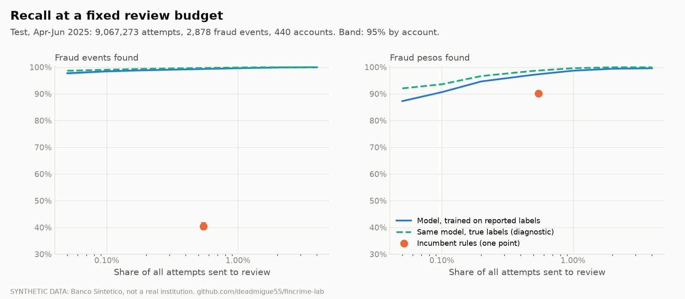
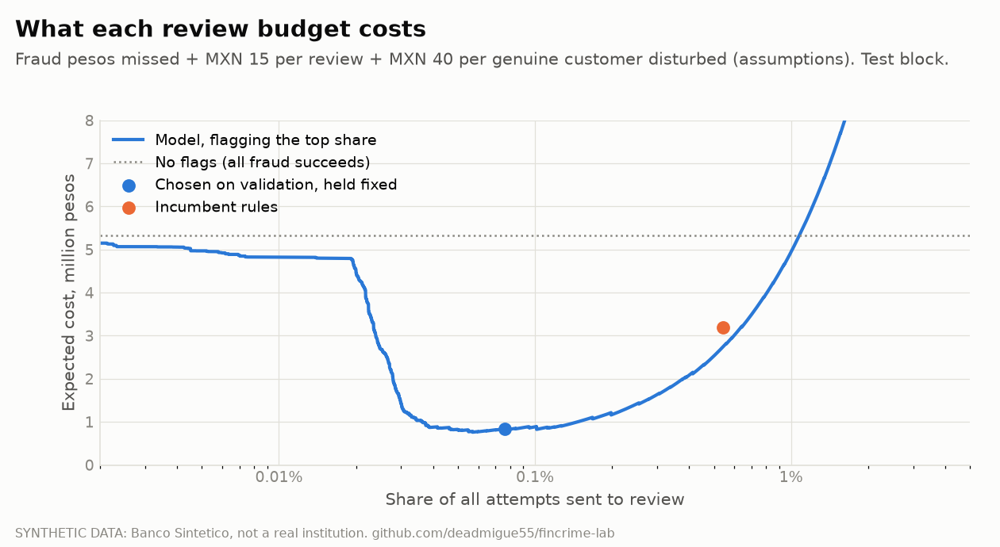
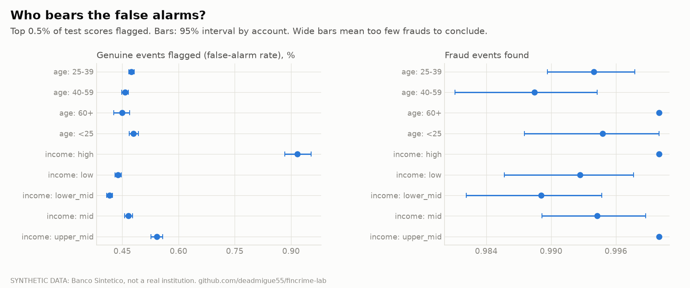
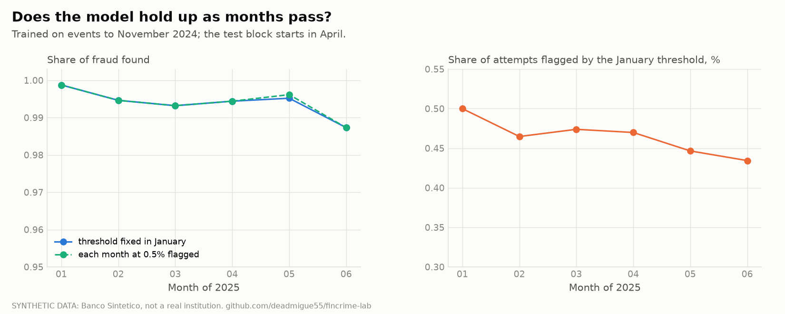

# Fraud models (step 6)

Do rules or a model do better at a fixed review budget, how much does it depend on delayed and
incomplete labels, who bears the false alarms, and does it hold up as months pass? Answered on the
synthetic bank under the protocol fixed in advance ([methodology.md](methodology.md) section 7),
then repeated on the public BAF benchmark. Code: `src/fincrime/fraud/`; raw results:
[docs/fraud-results/](fraud-results/). Reproduce: `fincrime fraud evaluate`, `fraud report`,
`fraud baf`, `fraud ablation`.

**Read this first.** On the synthetic bank the model is nearly perfect, and that says the
*pipeline* is sound, not how a bank would fare: the generator draws attacks from mechanisms
(a burst of small charges, a takeover from a new device) that the features express directly. On
BAF, a benchmark built to be hard, the same pipeline finds 55% of fraud at a 5% false-positive
rate. Both numbers are reported; neither is "the" result.

## Setup, as fixed before fitting

- **Scored:** every outgoing attempt (27.2M), before the decision. **Truth label:** account
  takeover and card testing (8,552 events, laundering excluded).
- **Test block:** April to June 2025, touched once: 9,067,273 attempts, 2,878 fraud events in 440
  accounts.
- **Training:** January to November 2024 with labels as they stood on 1 April 2025 (a purge gap of
  120 days, where 95% of reports have arrived). The label is *observed*: an approved event counts as
  fraud only if its victim reported it. Blocked attempts have no observed outcome and are left out.
  The model sees 1,417 observed frauds, against 2,917 real ones in the same period.
- **Four candidates** (logistic regression and three gradient-boosting sizes), chosen on a
  validation block (January and February 2025, 1,354 fraud events) by recall at a 0.5% flag share.
  Four were tried; the number is part of the result.
- **Incumbent:** the bank's own rule policy, read as one operating point: it sends 0.54% of
  attempts to review.
- **Intervals:** 95%, cluster bootstrap by account (300 replicates). Events of one account are
  not independent, so the effective sample is 440 accounts, not 2,878 events.

## Which model, and what the choice looked like

| Candidate | Recall at 0.5% flagged | Average precision |
|---|---|---|
| Logistic regression | 96.0% | 0.90 |
| Boosting, depth 3 | **99.5%** | **0.97** |
| Boosting, depth 6 | 99.5% | 0.86 |
| Boosting, depth 6, 400 rounds | 99.4% | 0.86 |

The smallest boosting model won: the deeper ones fit the thin positive class too closely (same
recall, much lower precision). One amendment to the protocol is on record: a smoke run before the
full run showed the boosting step exploding on weighted rare positives (margins in the millions), so
all boosting candidates use L2 = 1. It was made before any validation result was used.

## Headline: rules against the model at the same workload

| Review budget | Fraud events found (model) | 95% interval | Incumbent rules |
|---|---|---|---|
| 0.1% of attempts | 98.4% | 98.0 to 98.9 | |
| 0.5% of attempts | 99.3% | 99.0 to 99.5 | |
| 0.54% (the incumbent's own) | 99.3% | 99.0 to 99.6 | **40.4%** (39.2 to 41.9) |
| 1% of attempts | 99.6% | 99.3 to 99.8 | |
| FPR 5% | 99.9% | 99.8 to 100 | |

At equal workload the model finds 58.9 points more fraud events (57.4 to 60.0). ROC-AUC is 0.9992
and average precision 0.95. That is the *event* count, and it flatters the model, so read the
breakdown:

| Kind of fraud | Events | Median amount | Model finds (events / pesos) | Incumbent flags (events / pesos) | Incumbent actually stops (events / pesos) |
|---|---|---|---|---|---|
| Card testing | 2,596 | MXN 33 | 99.7% / 96.2% | 36.4% / 87.9% | 34.7% / 59.7% |
| Account takeover | 282 | MXN 7,603 | 95.7% / 97.7% | 77.0% / 91.5% | 58.5% / 70.8% |
| **All** | 2,878 | MXN 36 | 99.3% / **97.1%** | 40.4% / **90.2%** | 37.1% / 66.8% |

In **pesos** the gap is 90% against 97%, not 40% against 99%: the incumbent's amount rules already
catch the large takeovers, and what it misses are mostly card testing: a median charge of MXN 33,
with a few large cash-outs that bring the total to MXN 1.9M of the quarter's 5.3M. Card testing is
also how stolen card numbers get validated before the real theft, which is not modelled here. Two comparisons are deliberately equal-footing and so generous to the
rules: both are credited with preventing every flagged fraud. The last column shows the incumbent
as it actually performs, because an attacker can pass a step-up check (clone devices, 30% of
takeovers by assumption). The model's flags would face the same leak.

**What the labels cost.** The same model trained on true labels over every attempt (impossible at a
bank) finds 99.7% at 0.5%, against 99.3%. Delayed, incomplete and approved-only labels cost
0.4 points here, because the signal is crisp. With a faint signal this gap would be larger.

## What carries the result

Leave one feature family out, refit, and score the validation block:

| Family left out | Recall at 0.5% | Average precision |
|---|---|---|
| none | 99.5% | 0.970 |
| **velocity** | **82.6%** | **0.534** |
| **novelty** (new device, new payee) | 96.9% | 0.706 |
| friction (earlier declines) | 98.6% | 0.838 |
| event (amount, hour, type) | 98.4% | 0.945 |
| baseline, money, device sharing, history, account | 99.2% to 99.6% | 0.965 to 0.970 |

No single feature does the work, and it is the planted mechanisms that matter: burst velocity for
card testing, novelty for takeovers. One warning for anyone deploying this: the *friction* family
is built from the incumbent's own declines. Replace the incumbent and those inputs change, a
feedback loop this static evaluation cannot show. Step 8 re-runs the world under other rule
policies to test rules and estimators; it does not re-score this model, so the loop is untested.

## Cost, and the best review budget

Costs are assumptions, not data: MXN 15 per review, MXN 40 per genuine customer disturbed, a
flagged fraud assumed prevented. The review budget was chosen on validation (0.076% of attempts)
and held fixed on the test block:

| Unit costs | No flags | Incumbent rules | Model at the validated budget | Saving vs rules (95%) |
|---|---|---|---|---|
| Half | 5.33M | 1.86M | 0.70M | 1.16M (0.91 to 1.35) |
| **As stated** | 5.33M | 3.19M | **0.84M** (0.60 to 1.09) | **2.35M** (2.11 to 2.56) |
| Double | 5.33M | 5.86M | 1.10M | 4.76M (4.52 to 4.99) |

Millions of pesos over the three test months. The rules sit to the right of the cost minimum: they
review about seven times more attempts than is worth it, and at double the costs they cost *more than doing
nothing*. The model's budget is small (about 7,000 reviews in a quarter) because most of the money
is in a few hundred takeovers.

## Fairness at a shared threshold

Top 0.5% of test scores flagged; false-alarm rate = share of genuine events flagged.

- **Age and sex:** 0.45% to 0.48% in every age band and 0.47% for both sexes. States: 0.43% to
  0.54%. No disparity, as expected: the generator treats groups identically.
- **Income:** the high-income band is flagged **0.92%** of the time (0.88 to 0.95), about double the
  others (0.42% to 0.54%). Larger amounts look unusual against the account's own history. A real
  finding about the features, not about the simulator's design.
- **Recall by group** is 95% or higher wherever it can be measured; groups with a handful of
  fraudulent accounts (a few states) have intervals too wide to conclude, and say so on the figure.

## Drift

Threshold fixed in January: recall 99.9% in January, 98.7% in June; the share flagged slides from
0.50% to 0.43%. The score's distribution barely moves (PSI at most 0.005). Two inputs drift hard,
tenure (account age PSI 0.46 to 0.91; prior events 0.23 to 0.51, where 0.25 is the usual "major
shift" mark), simply because the bank's accounts get older, and the ablation shows the model does
not rely on them. The simulator holds the attack mix constant, so this shows *stability by
construction* plus ageing; it cannot show adaptation by attackers, the thing that breaks real
models.

## External check: BAF

Same pipeline, same four candidates, the dataset's own split (train months 0 to 5, test months 6
and 7), Base variant, 1,000,000 applications at 1.1% fraud. The boosting depth-3 model won again.
Test: 205,011 applications, 2,878 frauds (the same count as the synthetic test block, by coincidence), applications resampled for the intervals.

| False-positive rate | Fraud found | 95% interval |
|---|---|---|
| 0.5% | 17.6% | 16.3 to 19.1 |
| 1% | 25.9% | 24.5 to 27.6 |
| **5%** | **54.7%** | 52.7 to 56.5 |

ROC-AUC 0.896, average precision 0.20. This is account-opening fraud and a different problem from
the bank's payment fraud, so the numbers are not comparable; what they show is that the pipeline
behaves sensibly when the signal is hard. The dataset's fairness question reproduces: at a single
5% threshold, applicants aged 50 and over are flagged **11.4%** of the time (11.0 to 11.7) against
**3.8%** (3.7 to 3.9) for younger ones, three times as often, while 68% of their fraud is found
against 47%. This is a real-data warning about group error rates that the synthetic bank, by
construction, cannot give. I have not compared with published BAF figures; check the dataset's
paper before quoting any.

## Limits

- One simulated world, one seed, one split. Intervals are by account within that world, not across
  worlds.
- Two kinds of fraud only (takeover and card testing). Money laundering is the AML module.
- The signal is strong because the features mirror the generator's mechanisms; the BAF result is the
  honest counterweight. IEEE-CIS is not yet used (its competition rules still need accepting).
- Unit costs are assumptions, shown at half and double. A step-up check an attacker can pass is not
  modelled for the model's flags.
- No attacker adaptation to the new model: not tested (step 8 tests rule changes, not this model).
