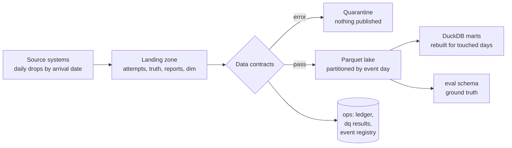

# The data platform (step 4)

How the synthetic bank's data moves from daily source drops to queryable tables, what is
guaranteed along the way, and what running it at scale taught us.



## Layers

| Layer | What it holds | Notes |
|---|---|---|
| Landing | Files exactly as delivered, one folder per **arrival** date | 3% of events arrive 1 to 3 days after they happened |
| Lake | Parquet, one folder per **event** day, never edited in place | Each drop writes its own files (`drop-<date>-*.parquet`) |
| `dim`, `mart` | Observable accounts and day-level marts | Rebuilt only for the event days a drop touched |
| `eval` | Ground truth (fraud labels, ring ids) | Evaluation code only; a model never reads this schema |
| `ops` | Load ledger, contract results, event registry | The platform's own memory |

Observables and truth are separated at the landing zone, not only in the warehouse: the
`attempts` files contain no label column at all.

## Guarantees, each with a test (`tests/test_lake.py`)

- **Idempotent.** Loading a drop twice, or reloading everything with `--force`, leaves the lake and
  every mart unchanged.
- **Incremental equals batch.** Loading in pieces gives the same result as loading at once.
- **Correctable.** A drop re-delivered with different content is detected by its fingerprint and
  replaces the old version, with no duplicates left behind.
- **Late data.** A drop that contains events from earlier days rebuilds only those days.
- **Safe.** A drop that breaks an `error` contract is quarantined and publishes nothing: five
  corruptions are tested (negative amounts, duplicates, unknown vocabulary, orphan accounts,
  events from the future).
- **Recoverable.** A crash after publishing but before the ledger is written leaves a `started`
  drop that the next run redoes; the result equals a clean load.
- **Marts agree with the source.** Mart totals equal the same queries run on the original files.

## Data contracts

| Contract | Severity | What it protects |
|---|---|---|
| required columns not null; amounts positive | error | basic integrity |
| event ids unique in the drop and across the lake | error | no double counting |
| allowed values; decision consistent with status | error | vocabulary and logic |
| account exists; not before it opened; not from the future | error | referential and temporal sense |
| truth matches attempts one to one | error | labels line up with events |
| report has an event and a report time | error, **reports only** | a bad reports file holds back only the reports |
| report refers to a delivered event | warn | out-of-order delivery (see below) |
| late-arrival share; volume vs recent median | warn | feed health |

## What running it at full scale found

The 12 first tests passed on small data. The first real run on 200,000 customers (597 drops,
34.7 million events) exposed two design flaws that small data could not:

1. **A quadratic cost.** Checking fraud reports against the lake scanned every event id ever
   loaded, on almost every drop, so each drop got slower than the last (13 drops in four minutes
   at the point I stopped it, against about one per second at the start). The fix is an **event
   registry**: a keyed table that makes both the duplicate check and the report check point
   lookups.
2. **Rejecting valid out-of-order data, with a cascade.** A victim can report a takeover before the
   late-arriving transaction itself reaches the platform. The contract rejected such reports and,
   because a drop was one unit, quarantined its 100,000 transactions too; those never entered the
   registry, so later reports about them failed as well. 185 of 597 drops (16.5 million rows) were
   quarantined over a handful of reports. The fix has two parts: a report for a not-yet-seen event
   is a **warning with a monitored orphan count** (a report is a fact that can legitimately precede
   its event), and a genuinely malformed report file now holds back **only the reports**.

After the fix the same run loads all 597 drops with none quarantined, and every report finds its
event (orphan count 0). Eight warnings remain, all explained: two are reports that arrived before
their event, three are the small tail of late data after the bank's last day, three are volume
alerts on those same tail days.

One threshold was changed after seeing results and is documented as such: the volume alert first
used 50% to 200% of the recent median and raised 32 false alarms, all month-end and mid-month pay
days (volume +40%) and the launch month. It now uses 40% to 300% with at least seven prior drops.

Full load: 34.7 million events, 597 drops, 15 minutes, on a laptop (contracts, publishing and all
marts included).

## Scaling benchmark

`fincrime lake benchmark` times seven canonical queries (scan and aggregate, group by account,
distinct counts, transfer-edge table, join, rolling 24-hour velocity, read one day) on prefixes of
AMLworld HI-Large from 1 million to its full 179,702,229 rows (the row count matches the published
figure). The protocol is in `src/fincrime/lake/benchmark.py`: three runs per query and the
median (a single run when the first exceeds two minutes), peak memory sampled every 50 ms, results
saved after every measurement, DuckDB capped at half the machine's memory with disk spill, and
`--resume` to continue an interrupted run.

**Status: the final numbers are not published yet.** A first run without the memory cap was stopped
at 180 million rows because the distinct-count query was pushing the machine toward its memory
limit; that is why the cap, the spill directory and incremental saving were added. The figures and
`docs/benchmark-scaling.md` will be generated from a clean, capped run.

## Run it

```powershell
uv run fincrime bank build --customers 200000
uv run fincrime lake export-landing
uv run fincrime lake load          # idempotent: run it again and nothing changes
uv run fincrime lake status
uv run fincrime ingest convert amlworld --sizes large --kinds HI
uv run fincrime lake benchmark --layouts
uv run fincrime lake benchmark-report
```
