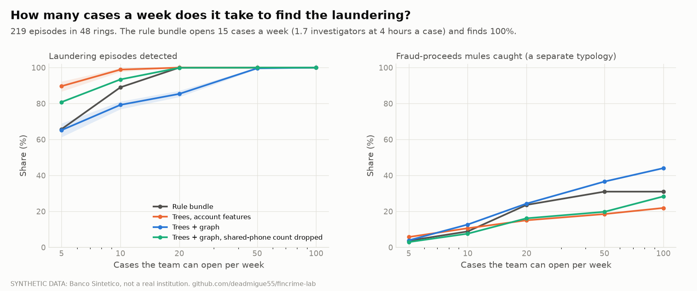

::: {.callout-warning}
## Everything here is synthetic
The bank is a simulator (Banco Sintético), not a real institution. Methods are tested against
planted truth, so findings about *method* transfer and findings about *level* (how much fraud is
caught, what capital is) do not. External checks on public benchmarks are labelled as such.
:::

## Headline results

| Module | Question | Result |
|---|---|---|
| **Fraud scoring** | Rules or model, at the same review workload? | At 0.54% of attempts reviewed the model finds 99.3% of fraud events against 40.4% for the rules; on the hard BAF benchmark it finds 54.7% at 5% false positives. |
| **Fraud loss and capital** | How many claims are still to come, and what capital? | Capital MXN 2.12M (90% interval 1.14 to 3.77); the 90% forecast interval covered the realised loss in 92% of 200 banks. |
| **Experiments** | How wrong is an A/B test of a fraud rule? | Checking weekly gives a false winner in 28% of A/A tests; alpha-spending holds 3% to 3%. Fraud loss is underpowered at 100,000 customers per arm. |
| **AML** | Rules, trees or graph, and how many cases a week? | Rules find 100% of laundering episodes at 14.8 cases a week; trees find 90% against 66% at 5 cases; graph features are unstable here but lift AMLworld PR-AUC from 0.13 to 0.41. |

Each result has a protocol written before the models were scored (steps 6 to 8; step 9 is attested
in text only), a read-only code review by a second reader (steps 7 to 9, not an independent validation), and a limit stated next to it.
Two checks fell short and are reported as such: the takeover-loss A/A rate (4.0% against a 4.1%
band edge) and detection of an outcome-dependent sample loss (83.9%). The AML comparison at 20 cases a
week is saturated and cannot rank detectors.

## Explore

```{ojs}
//| echo: false
data = ({"shares":[{"share":0.0005,"recall":0.9770674079221682,"lo":0.9713148643755869,"hi":0.9821717427984545},{"share":0.001,"recall":0.9843641417651147,"lo":0.9797088639257316,"hi":0.9888054859111545},{"share":0.002,"recall":0.9885337039610841,"lo":0.9847896403510386,"hi":0.9921833622624419},{"share":0.005,"recall":0.9927032661570535,"lo":0.9899331511745803,"hi":0.9953893929852633},{"share":0.01,"recall":0.9958304378040306,"lo":0.9931948041958715,"hi":0.9980487179878474},{"share":0.02,"recall":0.9986101459346769,"lo":0.996969696969697,"hi":0.9996776804423648},{"share":0.04,"recall":0.9993050729673384,"lo":0.9981306049517984,"hi":1.0}],"incumbent":{"share":0.005443202162325983,"recall":0.4041000694927033},"cost":{"0.5":{"model":701597.65,"incumbent":1856586.47,"none":5331368.779999999,"saving":[1154988.82,912086.7725,1351957.63025]},"1.0":{"model":835715.15,"incumbent":3190588.9699999997,"none":5331368.779999999,"saving":[2354873.8200000003,2110522.1475,2557637.50675]},"2.0":{"model":1097723.1400000001,"incumbent":5858593.970000001,"none":5331368.779999999,"saving":[4760870.83,4520529.9344999995,4985362.583]}},"aml":{"1":{"5":{"M0cut":{"recall":0.8812785388127854,"lo":0.8812785388127854,"hi":0.8812785388127854},"M1":{"recall":0.8365296803652967,"lo":0.8036529680365296,"hi":0.8995433789954338},"M2":{"recall":0.9442922374429225,"lo":0.9315068493150684,"hi":0.954337899543379},"M2n":{"recall":0.8958904109589041,"lo":0.684931506849315,"hi":0.958904109589041}},"10":{"M0cut":{"recall":0.9908675799086758,"lo":0.9908675799086758,"hi":0.9908675799086758},"M1":{"recall":0.9652968036529679,"lo":0.9497716894977168,"hi":0.9863013698630136},"M2":{"recall":0.9908675799086758,"lo":0.9863013698630136,"hi":0.9954337899543378},"M2n":{"recall":0.9853881278538813,"lo":0.9634703196347032,"hi":0.9954337899543378}},"20":{"M0cut":{"recall":1.0,"lo":1.0,"hi":1.0},"M1":{"recall":0.9972602739726026,"lo":0.9908675799086758,"hi":1.0},"M2":{"recall":0.9981735159817351,"lo":0.9954337899543378,"hi":1.0},"M2n":{"recall":0.9936073059360732,"lo":0.9908675799086758,"hi":0.9954337899543378}},"50":{"M0cut":{"recall":1.0,"lo":1.0,"hi":1.0},"M1":{"recall":1.0,"lo":1.0,"hi":1.0},"M2":{"recall":1.0,"lo":1.0,"hi":1.0},"M2n":{"recall":0.9990867579908677,"lo":0.9954337899543378,"hi":1.0}},"100":{"M0cut":{"recall":1.0,"lo":1.0,"hi":1.0},"M1":{"recall":1.0,"lo":1.0,"hi":1.0},"M2":{"recall":1.0,"lo":1.0,"hi":1.0},"M2n":{"recall":1.0,"lo":1.0,"hi":1.0}}},"2":{"5":{"M0cut":{"recall":0.8082191780821918,"lo":0.8082191780821918,"hi":0.8082191780821918},"M1":{"recall":0.8684931506849315,"lo":0.7625570776255708,"hi":0.9178082191780822},"M2":{"recall":0.6374429223744292,"lo":0.0410958904109589,"hi":0.9315068493150684},"M2n":{"recall":0.8127853881278538,"lo":0.771689497716895,"hi":0.9041095890410958}},"10":{"M0cut":{"recall":0.9817351598173516,"lo":0.9817351598173516,"hi":0.9817351598173516},"M1":{"recall":0.9780821917808219,"lo":0.9497716894977168,"hi":0.9954337899543378},"M2":{"recall":0.8073059360730593,"lo":0.2054794520547945,"hi":0.9954337899543378},"M2n":{"recall":0.9579908675799086,"lo":0.908675799086758,"hi":0.9771689497716894}},"20":{"M0cut":{"recall":1.0,"lo":1.0,"hi":1.0},"M1":{"recall":0.9972602739726026,"lo":0.9908675799086758,"hi":1.0},"M2":{"recall":0.978082191780822,"lo":0.9041095890410958,"hi":1.0},"M2n":{"recall":0.9981735159817351,"lo":0.9954337899543378,"hi":1.0}},"50":{"M0cut":{"recall":1.0,"lo":1.0,"hi":1.0},"M1":{"recall":1.0,"lo":1.0,"hi":1.0},"M2":{"recall":1.0,"lo":1.0,"hi":1.0},"M2n":{"recall":1.0,"lo":1.0,"hi":1.0}},"100":{"M0cut":{"recall":1.0,"lo":1.0,"hi":1.0},"M1":{"recall":1.0,"lo":1.0,"hi":1.0},"M2":{"recall":1.0,"lo":1.0,"hi":1.0},"M2n":{"recall":1.0,"lo":1.0,"hi":1.0}}},"4":{"5":{"M0cut":{"recall":0.6575342465753424,"lo":0.6575342465753424,"hi":0.6575342465753424},"M1":{"recall":0.8968036529680365,"lo":0.8356164383561644,"hi":0.9406392694063926},"M2":{"recall":0.6520547945205478,"lo":0.0228310502283105,"hi":0.8858447488584474},"M2n":{"recall":0.8082191780821918,"lo":0.639269406392694,"hi":0.8812785388127854}},"10":{"M0cut":{"recall":0.8904109589041096,"lo":0.8904109589041096,"hi":0.8904109589041096},"M1":{"recall":0.9890410958904109,"lo":0.9817351598173516,"hi":0.9954337899543378},"M2":{"recall":0.7926940639269408,"lo":0.0821917808219178,"hi":0.9817351598173516},"M2n":{"recall":0.9342465753424657,"lo":0.867579908675799,"hi":0.9771689497716894}},"20":{"M0cut":{"recall":1.0,"lo":1.0,"hi":1.0},"M1":{"recall":1.0,"lo":1.0,"hi":1.0},"M2":{"recall":0.8538812785388129,"lo":0.2694063926940639,"hi":1.0},"M2n":{"recall":0.9990867579908677,"lo":0.9954337899543378,"hi":1.0}},"50":{"M0cut":{"recall":1.0,"lo":1.0,"hi":1.0},"M1":{"recall":1.0,"lo":1.0,"hi":1.0},"M2":{"recall":0.9963470319634703,"lo":0.9817351598173516,"hi":1.0},"M2n":{"recall":1.0,"lo":1.0,"hi":1.0}},"100":{"M0cut":{"recall":1.0,"lo":1.0,"hi":1.0},"M1":{"recall":1.0,"lo":1.0,"hi":1.0},"M2":{"recall":1.0,"lo":1.0,"hi":1.0},"M2n":{"recall":1.0,"lo":1.0,"hi":1.0}}},"13":{"5":{"M0cut":{"recall":0.3150684931506849,"lo":0.3150684931506849,"hi":0.3150684931506849},"M1":{"recall":0.897716894977169,"lo":0.8721461187214612,"hi":0.9360730593607306},"M2":{"recall":0.7744292237442923,"lo":0.7488584474885844,"hi":0.8127853881278538},"M2n":{"recall":0.8054794520547945,"lo":0.7671232876712328,"hi":0.8995433789954338}},"10":{"M0cut":{"recall":0.54337899543379,"lo":0.54337899543379,"hi":0.54337899543379},"M1":{"recall":0.9926940639269407,"lo":0.9817351598173516,"hi":1.0},"M2":{"recall":0.9643835616438355,"lo":0.958904109589041,"hi":0.9771689497716894},"M2n":{"recall":0.9726027397260274,"lo":0.9497716894977168,"hi":0.9863013698630136}},"20":{"M0cut":{"recall":0.8310502283105022,"lo":0.8310502283105022,"hi":0.8310502283105022},"M1":{"recall":1.0,"lo":1.0,"hi":1.0},"M2":{"recall":1.0,"lo":1.0,"hi":1.0},"M2n":{"recall":0.9990867579908677,"lo":0.9954337899543378,"hi":1.0}},"50":{"M0cut":{"recall":1.0,"lo":1.0,"hi":1.0},"M1":{"recall":1.0,"lo":1.0,"hi":1.0},"M2":{"recall":1.0,"lo":1.0,"hi":1.0},"M2n":{"recall":1.0,"lo":1.0,"hi":1.0}},"100":{"M0cut":{"recall":1.0,"lo":1.0,"hi":1.0},"M1":{"recall":1.0,"lo":1.0,"hi":1.0},"M2":{"recall":1.0,"lo":1.0,"hi":1.0},"M2n":{"recall":1.0,"lo":1.0,"hi":1.0}}}},"scenarios":[{"name":"No new accounts","el":6396506.434399273,"el_lo":5275058.608932261,"el_hi":7892093.373915222,"cap":1839243.5656007268,"cap_lo":970558.4457649114,"cap_hi":3252390.106686598},{"name":"Base","el":9022464.224387458,"el_lo":7440628.412520376,"el_hi":11132034.46333075,"cap":2115185.7756125424,"cap_lo":1140049.803086506,"cap_hi":3769796.3882259354},{"name":"High onboarding (+50%)","el":10335443.108547341,"el_lo":8523413.297155656,"el_hi":12752005.011030138,"cap":2237956.891452659,"cap_lo":1217354.819507916,"cap_hi":4016310.053534446},{"name":"Never-reported gross-up 0.5","el":9590911.075407539,"el_lo":7791945.740008484,"el_hi":11731406.975435529,"cap":2168338.9245924614,"cap_lo":1158332.5639964403,"cap_hi":3927144.9425869985},{"name":"Never-reported gross-up 1","el":10259008.302061385,"el_lo":8336551.970639645,"el_hi":12545948.495570013,"cap":2228691.6979386155,"cap_lo":1189685.1380812773,"cap_hi":4097971.858474527},{"name":"Never-reported gross-up 2","el":12061103.164400488,"el_lo":9763753.501128852,"el_hi":14933849.780447263,"cap":2381696.835599512,"cap_lo":1262700.0622254438,"cap_hi":4522950.397598589},{"name":"Lognormal severity (rejected misfit)","el":6807344.337891102,"el_lo":5733923.378005301,"el_hi":7980980.5957564125,"cap":967305.6621088982,"cap_lo":805251.8825408287,"cap_hi":1394187.2935750703}],"models":[{"id":"M0cut","label":"Rule bundle"},{"id":"M1","label":"Trees"},{"id":"M2","label":"Trees + graph"},{"id":"M2n","label":"No phone count"}]})
```

::: {.panel-tabset}

### Fraud: review budget

How much fraud does the model find as the review team gets bigger? The bank's own rules are one
point on the chart: they send 0.54% of attempts to review.

```{ojs}
//| echo: false
viewof sel = Inputs.select(data.shares, {format: d => (100 * d.share).toFixed(2) + "%", value: data.shares[3], label: "Share of attempts reviewed"})
md`**${(100 * sel.share).toFixed(2)}% of attempts reviewed:** the model finds **${(100 * sel.recall).toFixed(1)}%** of fraud events (95% interval ${(100 * sel.lo).toFixed(1)} to ${(100 * sel.hi).toFixed(1)}). The rules find **${(100 * data.incumbent.recall).toFixed(1)}%** at ${(100 * data.incumbent.share).toFixed(2)}%.`
```

```{ojs}
//| echo: false
Plot.plot({
  height: 320, marginLeft: 50, x: {type: "log", label: "Share of attempts reviewed", ticks: data.shares.map(d => d.share), tickFormat: d => d3.format("~g")(100 * d) + "%"},
  y: {label: "Fraud events found", domain: [0, 1], tickFormat: d => (100 * d) + "%"},
  marks: [
    Plot.areaY(data.shares, {x: "share", y1: "lo", y2: "hi", fillOpacity: 0.2, fill: "#2a76d6"}),
    Plot.line(data.shares, {x: "share", y: "recall", stroke: "#2a76d6", strokeWidth: 2}),
    Plot.dot(data.shares, {x: "share", y: "recall", fill: "#2a76d6"}),
    Plot.dot([data.incumbent], {x: "share", y: "recall", fill: "#e8693a", r: 6}),
    Plot.text([data.incumbent], {x: "share", y: "recall", text: ["Bank's rules"], dy: 14, fill: "#e8693a"}),
    Plot.ruleX([sel.share], {stroke: "#888", strokeDasharray: "3,3"})
  ]
})
```

```{ojs}
//| echo: false
viewof mult = Inputs.radio(["0.5", "1.0", "2.0"], {value: "1.0", label: "Unit costs (reviews MXN 15, disturbed customer MXN 40) times"})
c = data.cost[mult]
md`Expected cost over the three test months at the validated budget: **model MXN ${(c.model / 1e6).toFixed(2)}M**, rules MXN ${(c.incumbent / 1e6).toFixed(2)}M, no flags MXN ${(c.none / 1e6).toFixed(2)}M. Saving against the rules **MXN ${(c.saving[0] / 1e6).toFixed(2)}M** (95% interval ${(c.saving[1] / 1e6).toFixed(2)} to ${(c.saving[2] / 1e6).toFixed(2)}).`
```

### AML: cases a week

How many cases must the team open each week to find the laundering? Bars are the mean of five refits;
the whisker is the range of the refits.

```{ojs}
//| echo: false
viewof lookback = Inputs.radio(["1", "2", "4", "13"], {value: "4", label: "Lookback (weeks)"})
viewof budget = Inputs.radio(["5", "10", "20", "50", "100"], {value: "5", label: "Cases a week"})
rows = data.models.map(m => ({label: m.label, ...data.aml[lookback][budget][m.id]}))
md`**${budget} cases a week** is about ${(budget * 4 / 35).toFixed(1)} full-time investigators (4 hours a case, 35 hours a week, both assumptions).`
Plot.plot({
  height: 280, marginLeft: 110, x: {label: "Laundering episodes detected", domain: [0, 1], tickFormat: d => (100 * d) + "%"},
  y: {label: null},
  marks: [
    Plot.barX(rows, {y: "label", x: "recall", fill: "#2a76d6"}),
    Plot.ruleY(rows, {y: "label", x1: "lo", x2: "hi", stroke: "#222", strokeWidth: 2}),
    Plot.text(rows, {y: "label", x: "recall", text: d => (100 * d.recall).toFixed(0) + "%", dx: -18, fill: "white"})
  ]
})
```

The graph model is unstable at 2 and 4 weeks (look at its whisker at 5 cases) and stable at 1 week.
The comparison at 20 cases a week is saturated: every detector finds nearly everything.

### Fraud loss: capital

Annual fraud loss and the capital to hold against a 1-in-200 year, under the scenarios in the write-up.
The lognormal row is a model the held-out data rejected; it shows how far the answer can move.

```{ojs}
//| echo: false
viewof scen = Inputs.select(data.scenarios.map(s => s.name), {value: "Base", label: "Scenario"})
s = data.scenarios.find(d => d.name === scen)
md`**Expected annual loss MXN ${(s.el / 1e6).toFixed(2)}M** (90% interval ${(s.el_lo / 1e6).toFixed(2)} to ${(s.el_hi / 1e6).toFixed(2)}). **Capital (VaR 99.5% minus expected loss) MXN ${(s.cap / 1e6).toFixed(2)}M** (${(s.cap_lo / 1e6).toFixed(2)} to ${(s.cap_hi / 1e6).toFixed(2)}).`
```

:::

## Figures

::: {layout-ncol=2}





:::

## Documents

- [Plan and results table](https://github.com/deadmigue55/fincrime-lab/blob/main/docs/plan.md) and the [README](https://github.com/deadmigue55/fincrime-lab#readme)
- Fraud: [features](https://github.com/deadmigue55/fincrime-lab/blob/main/docs/fraud-features.md), [models](https://github.com/deadmigue55/fincrime-lab/blob/main/docs/fraud-models.md)
- [Fraud loss and IBNR](https://github.com/deadmigue55/fincrime-lab/blob/main/docs/fraud-loss.md)
- [Experiment lab](https://github.com/deadmigue55/fincrime-lab/blob/main/docs/experiment-lab.md)
- [AML module](https://github.com/deadmigue55/fincrime-lab/blob/main/docs/aml.md)
- [Governance pack](https://github.com/deadmigue55/fincrime-lab/blob/main/docs/governance/README.md): model cards, validation report with a 32-finding register, monitoring plan
- [Methodology and protocols](https://github.com/deadmigue55/fincrime-lab/blob/main/docs/methodology.md)

## Reproduce

```
uv sync
uv run fincrime bank build --customers 200000
uv run fincrime fraud evaluate && uv run fincrime risk report && uv run fincrime aml run
uv run fincrime site            # rewrites and renders this page
```

*Built by Miguel Abarca.* The code and every protocol are in the
[repository](https://github.com/deadmigue55/fincrime-lab).
